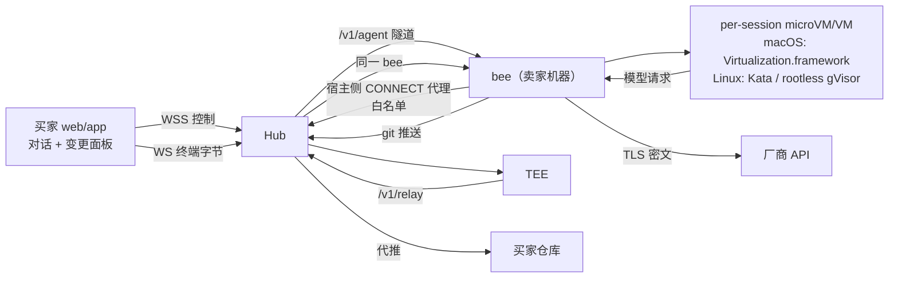

# TokenHive 远程工作区市场：运行架构与计费规则

日期：2026-11-24（第五版，改动见 §11）
状态：设计提案，v1 实现中
定位：本文回答一个具体问题——买家从网页端打开一个运行在卖家电脑上的执行环境，在里面跑 agent、clone 代码、开发、提交，这套东西怎么运行、怎么计费。本文不讨论封号问题。

---

## 0. 一句话

把"一次 HTTP 请求"的作业模型升级成"一段占用时间"的会话模型，但 v1 卖的是**预付任务块**而不是秒：**块数归 Hub，时长只由 Hub 用来判断上限，卖家只能让会话走得更慢（断线），不能让它走得更快；模型凭据仍然只在 TEE 里，永不下发到卖家机器；隔离边界是每会话一台 microVM/VM，不是容器。**

---

## 1. 产品定义与边界

卖的不是"卖家的 Claude 额度"，是**卖家机器的一段隔离运行时**：CPU、内存、磁盘、网络出口，以及一个预先装好工具链的 agent 环境。

买家看到的形态：以网页里的 agent 对话面板为主，**外加一个变更面板**——diff、测试输出、产物清单、每次工具调用的入参与影响。变更面板不是可选的装饰：§6 把"买家 review 每个 diff"当作卖家埋后门的唯一防线，一个只有聊天气泡的界面等于把这条防线删掉。终端与文件树可以有，但在 v1 里是变更面板的下钻视图，而不是入口。

关掉页面不等同于停止：停止由 Hub 决定，v1 的规则是"空闲或 TTL 到期即结束"（§3.3、§4.8）。

明确不做的事：

| 不做 | 原因 |
|---|---|
| 把买家代码放进卖家主机的用户上下文 | 等价于把买家 RCE 交给卖家，见 §6 |
| 让卖家把宿主目录挂进沙箱（"就用我现有的那个目录"） | 一次 `-v $HOME` 就是全部泄露；环境只能以 OCI 环境包的形式导入，见 §3.6 |
| 把模型凭据下发到卖家机器 | 卖家能读，买家代码也能读，见 §3.5 |
| 承诺"卖家看不到你的代码" | 消费级硬件无 SEV-SNP/TDX，见 §8 |
| 承诺"工作区确实运行了 N 秒"的密码学证明 | 时长不产生字节，无法被流摘要覆盖，见 §7；v1 因此不按秒卖 |
| 用容器（runc/Docker）当隔离边界 | 共享内核 + `docker.sock` 等价卖家 root，见 §3.4 |

---

## 2. 与现有系统的关系

| 能力 | 现状 | 工作区产品中的角色 |
|---|---|---|
| 反向隧道 `tunnel/` | 已有 | 复用：工作区控制流与终端流都走这条 WebSocket |
| `/v1/agent` AgentGate | 已有 | 复用：bee 注册、在线判定、按 provider 路由 |
| `/v1/relay` TeeRelay | 已有 | 复用：模型流量的出口 |
| `egress` 的 CONNECT 白名单与限速 | 已有 | **复用**：沙箱的唯一出站路径（§3.2 第 4 点） |
| `tee/session.go` 会话字节管道 | 已有 | **不能直接复用**：它绑定一条 `jobs.Spec`（一次 HTTP Upgrade），不是长生命周期工作区 |
| `proof/` 回执与流摘要 | 已有 | 扩展：新增"工作区产物回执" |
| `hub/rates.go` RateCard | 已有 | 扩展：新增工作区块价格，不替换 |
| `hub/budget.go` Budget | 已有 | 复用：累计上限 |
| 凭据信封 `tee/credential.go` | 已有 | 复用：模型凭据仍由 TEE 注入 |

新增的部分有五块：工作区注册表、生命周期状态机、资源档位与块计价、卖家侧 supervisor 与运行时、环境包与镜像存储。

---

## 3. 运行架构

### 3.1 角色与信任假设

| 角色 | 可信度 | 能做什么 |
|---|---|---|
| 买家 | 不可信 | 提交任意代码、任意命令 |
| 卖家（bee） | 不可信 | 完全控制宿主机、可读沙箱磁盘、可断线、可自带环境包 |
| Hub | 半可信（平台自身） | 调度、记账、生命周期；是唯一的计费时钟 |
| TEE | 可信 | 持有模型凭据、终结到厂商的 TLS、签回执 |

买家防卖家，卖家防买家，双方都必须防平台算错账——最后一条靠 §4.4 的预付块与块数上限。还有第三条关系被这份设计第一次引入：**卖家自己的凭据要防买家代码**。沙箱里跑的是任意代码，而卖家的 `~/.ssh`、`~/.claude`、局域网就在同一台机器上，这条要求决定了 §3.4 不能是容器。

### 3.2 数据面



五个要点：

1. **v1 的模型流量不进入沙箱**。网页对话由 Hive 受理，走 Hive→Hub→TEE→卖家 bee→厂商：TEE 持厂商凭据、终结 TLS，出口仍是卖家 IP；沙箱里既没有厂商凭据，也没有 Hub 会话 key。工作区是另一条独立的数据面——买家在终端里运行工具、编译、测试，但不在这里发模型请求。

   这条边界是硬约束，不是分期取舍：沙箱里不能是"卖家那份已经登录的 claude/codex"，因为登录态就是厂商凭据；也不能把卖家的 refresh token 注入沙箱来"让 CLI 看起来像官方客户端"。P2 若要把 agent harness 放进沙箱，只能由 Hub 现场签发短 TTL 的 session key + Base URL（`ANTHROPIC_BASE_URL` / Codex `model_providers.base_url`），并且沙箱先具备 PTY、resize、信号与输出背压；v1 不实现这条路。§3.6 的环境包因此只卖**工具链与依赖**，不卖登录态。

2. **v1 的模型流量仍经卖家 bee 出网，只穿一次 bee↔Hub**（Hive→Hub→TEE→Hub→bee→厂商）。TEE 终结 TLS 并注入凭据，出口仍是卖家的住宅 IP，这是产品的核心；沙箱不在模型链路里，所以不再有"沙箱→bee"那一段。**卖家的家宽上行仍是共享瓶颈**：一次 agent turn 是几十次往返，每次带完整上下文，低价卖家的上行会被第一个会话占满。带宽因此是 §5 的一等调度输入。P2 把 harness 放进沙箱后，模型流量才会变成两次穿越，代价约两个 RTT。

3. **v1 沙箱完全离线，git push 不在沙箱里做**（也没有网络可做）。P2 开放出站后，推送仍应走 bee→Hub 代推：沙箱不持 git 凭据，Hub 用真实凭据代推。

4. **v1 沙箱 `--network=none`，没有 NAT、没有 DNS、没有 CONNECT 代理**。"打不到卖家的局域网、路由器管理页、`169.254.169.254`"是结构性事实，而不是靠 guest 内 iptables 规则维持的事实——后者买家有 root，能改。

   P2 开放出站时，guest 的出站只能有一个入口：宿主 bee 上仅绑定 loopback / unix socket 的 CONNECT 代理，白名单只放 Hub 的模型入口与 git 入口。**DNS 必须与出站同路径**：guest 里不能有 `/etc/resolv.conf` 指向卖家 ISP 的解析器，三个理由依次加重：没有路由（本来就不通）、那是一条绕过白名单的旁路信道（买家访问了什么，卖家看一眼 DNS 就知道）、解析结果会被卖家改写。落地只有两种形态：宿主 bee 提供 stub resolver，按会话转发到 Hub 的解析入口；或 guest 全局使用 DoH，且 DoH 端点本身在代理白名单内。**推荐前者**，它把"解析"和"出站"收敛到同一个鉴权点上。注意这条与 token 产品的结论不冲突——那里卖家本来就知道目标，这里买家不该知道。

5. **v1 不提供预览端口**。P2 的入站是预览端口，不是公网端口：路径只能是买家 → Hub → 隧道 → bee → guest 的端口转发，由 Hub 按会话鉴权；guest 自己不监听任何可达地址。**禁止把宿主端口暴露到局域网或公网**——那会把"卖家的机器"变成"买家的服务器"，从租算力变成提供托管，法律性质完全不同。可转发的端口清单随规格签名下发，bee 只放行清单内的端口，不允许买家在会话里动态新增。

### 3.3 生命周期状态机

```text
requested ──► starting ──► running ──► terminated           （v1）
                 │            │
                 └────────────┴──► suspending ──► suspended ──► terminated   （P2）
```

| 状态 | 期 | 计什么 | 谁能推进 |
|---|---|---|---|
| `requested` | v1 | 不计 | Hub |
| `starting` | v1 | 块已扣（有 120 s 上限） | Hub，判据是**首个成功转发的数据帧** |
| `running` | v1 | 块已扣，按时长判上限 | Hub（买家 stop / 空闲 / TTL / 块额度） |
| `terminated` | v1 | 无 | Hub |
| `suspending` | P2 | 不计 | Hub |
| `suspended` | P2 | 只计存储 | Hub |

**Hub 是唯一能改变状态的实体。** bee 只能上报"就绪""已断线"，在沙箱退出时推送一次事件，并在 Hub 查询时回答"还持有 / 已退出 / 不认识"；它不能上报时长，也不能自行推进计费状态。退出事件走一条 bee 主动打开的短流，因此无人 attach 的退出也能立刻到达 Hub，不必等到块结算或下一次 attach。

但"就绪"这个判据不能由 bee 来报。bee 说 ready 不花钱，却会让买家把 TTL 花在一个连不上的壳上，而 TTL 是买家付过的。v1 没有 PTY，也没有可依赖的"提示符"，所以 `starting → running` 的触发点定为**首个成功转发的终端数据帧（任一方向）**：Hive 把买家输入送进沙箱、或把沙箱输出送到买家，至少有一次端到端成功。bee 的"就绪"只用于启动失败计数与调度健康度，不推进状态机。

反方向同样要写死：**Hub 不可达时沙箱必须自毁**。bee 与 Hub 失联超过 60 s（含重连退避）即销毁该会话的全部实例并上报。这与"只有 Hub 能推进状态机"不矛盾——那条约束的是计费与生命周期决策；失联自毁是安全兜底：平台已经观测不到它，就不能让它继续以买家的名义执行代码。guest 内不设任何"本地续命"开关，卖家也不能通过断网把会话"冻结"在运行态。

v1 刻意不实现 `suspended`：会话结束就销毁，没有可恢复的挂起态。把 `suspending/suspended` 放进 P0，等于把最难做对的三件事——跨机器恢复、存储计量、快照一致性——压到第一个版本上，而它们对"聊天一次、看 diff、结束"这个主路径没有任何贡献。

### 3.4 隔离边界与运行时选型

**边界是每会话一台 microVM/VM，容器只允许出现在边界内部。** 不接受裸 runc 作为边界，理由不是洁癖：

| 用容器当边界的后果 | 具体机制 |
|---|---|
| 买家 A 能进买家 B 的会话 | 同一台机器上所有会话共享一个内核，一个 kernel LPE 就是跨租户逃逸 |
| 买家代码等于卖家 root（间接） | bee 要启动容器就得连 `docker.sock`；任何能影响 bee 的路径都等于 `--privileged -v /:/host` |
| 一次误用就漏整个 `$HOME` | `docker run` 的默认配置（Docker Desktop 默认共享 `/Users`）与"只有空卷"的要求相反，拼 argv 也挡不住 vendor 的默认值 |
| 一个会话能把同机所有会话拖死 | 同一台机器上的会话共享同一个 VM 与同一份内存压力，fork bomb 或 OOM 不是只杀自己 |

平台矩阵（bee 只支持 darwin/linux，Windows 不在范围内）：

| 平台 | 边界 | 实现 | 权限要求 |
|---|---|---|---|
| macOS | Apple Virtualization.framework，一会话一 Linux VM | 签名 App 带 `com.apple.security.virtualization`；Go 侧 `Code-Hex/vz` 一类绑定 | **零 root**，但 entitlement 需要带描述文件的正式签名，普通 CLI 二进制拿不到 |
| Linux（默认） | rootless gVisor `runsc` | 单文件 runtime，随 bee 下载并按 hash 钉住 | 非特权用户命名空间；不需要 root、不需要加 `docker` 组 |
| Linux（强化档，P3） | Kata Containers（Firecracker / Cloud Hypervisor 后端），一会话一 microVM | containerd shim；bee 通过一个窄接口特权 helper 调用 | 需卖家显式同意安装 helper；`kvm` 组 |

macOS 那一行的最后一句是个安装形态约束，不是细节：现在的 bee 是单文件 CLI（macOS 侧连后台服务都不管），而工作区模式必须跑在签名 App 里。所以 macOS 的工作区功能挂在已有的 Tauri App 上，CLI 保持"只做模型供给"；不要让 macOS 卖家为了开工作区去手工签名一个二进制。这也是它不可能用 Firecracker 的第二层原因（第一层是没有 KVM）。

**Windows 被排除的理由要写下来，否则以后一定会有人问"为什么不做"。** 不是因为工程量，是因为没有可用的按会话 VM：Docker Desktop 的所有容器跑在同一个 WSL2 VM 里，会话之间只隔 namespace 不隔内核；Hyper-V 只有 Pro/Enterprise/Education 有，Home 版没有；Windows 容器跑不了 Linux。推论是"一台 Windows 机器默认只能接一个买家"，而单机多会话正是这个产品摊薄成本的前提。将来若要支持，正确形态是提供一个可启动的 Linux 镜像让卖家刷机——把"不可控的个人电脑"变成"受控的硬件"，而不是在 Windows 上补一套隔离实现。

规则：**隔离等级按最弱平台统一，而不是按平台各写一套威胁模型。** 否则条款里要写两种安全承诺，买家不知道自己落在哪一侧。因此 macOS 一律 VM；Linux 的默认档至少是 gVisor（用户态内核，直接解决 §6 关心的 kernel 0-day），强化档才上 microVM。会话的 `isolation_tier` 对买家可见（§5），不满足买家声明的下限就不进入候选。

**不该自研的是隔离引擎本身。** 自己写命名空间/cgroup/seccomp/pivot_root 等于自己写一个未审计的容器运行时；直接用 Firecracker 裸跑则要自己承担 guest kernel、镜像转换、TAP/vsock 与两套平台的运维。该自研的是 supervisor：

| supervisor 职责 | 必须做到 |
|---|---|
| 规格验签 | 复用 `jobs.Spec` 的编码思路，钉住 Hub 公钥 |
| 独立校验 | 不信 Hub：镜像 digest 与架构匹配、资源不超过本机上限、挂载点不触犯禁止规则、entrypoint 在允许列表内。校验失败**拒绝启动并上报**，不静默降级 |
| 卷与配额 | 只有新建的空工作区卷；镜像只读；卖家侧磁盘配额与环境包体积上限（§3.6） |
| 资源 | vCPU 份额、内存硬上限 + OOM 击杀、**进程数上限**（fork bomb 只杀自己不能拖垮同机其它会话）、工作区卷容量上限（v1 用轮询额度，超限即停） |
| 终端 | **v1 不提供 PTY**，只有管道式 stdin/stdout；PTY 分配、多终端复用一条隧道流、resize / 信号 / 退出码属于 P2。**输出背压**必须做：买家跑一个 `yes` 不能把隧道和 Hub 打爆，限速做在 guest 侧，Hub 侧兜底只用来断开 |
| 网络 | **v1 固定 `--network=none`**，沙箱无出站、无 DNS；宿主侧 CONNECT 代理、DNS 同路径、预览端口转发都是 P2（§3.2 第 4、5 点） |
| 快照 | 分块、去重、可续传；快照前必须 quiesce（sync + 冻结文件系统），否则恢复出来是半写状态 |
| 心跳与自毁 | 与 Hub 失联 60 s 即销毁（§3.3，v1 已实现，含重连退避）；销毁的实例记为"失联丢失"，下次连上 Hub 时推送，由平台退款；bee 重启后回收孤儿实例（v1 已实现） |
| 上报 | 退出时主动推送一次"已退出 / 因失联销毁"；被查询时回答"还持有 / 已退出 / 不认识"；不报时长 |

理由不变：能启动 VM 的进程等价 root，Hub 被攻破不能变成全网卖家被打穿，所以校验必须在 bee 侧独立做一遍。

### 3.5 凭据与产物

| 东西 | 放哪 | 生命周期 |
|---|---|---|
| 厂商模型凭据 | 只在 TEE | 长期 |
| 会话模型 key | 沙箱内文件 | = 工作区存活期 |
| git 推送凭据 | 只在 Hub | 每次推送现签 |
| 买家工作区数据 | 沙箱卷 + Hub 对象存储快照（买家密钥加密） | 保留期（P2） |
| 环境包 | 卖家本地缓存 + Hub 对象存储（按 digest） | 长期，可 GC |
| 产物回执 | Hub | 长期 |

**快照落在 Hub 而不是卖家磁盘**，有两个原因：停机存储计费需要可观测的计量点，以及卖家拔电时买家最多损失一个快照周期。但这条有个工程约束必须写进来：

v1 不做快照（会话结束即销毁），而 P2 的快照**必须**是分块 + 去重 + 可续传的增量快照，并且对工作区体积设硬上限（建议 8 GiB）。原因是算术：10 Mbps 的家庭上行传 5 GiB 要约 67 分钟，50 Mbps 也要 13 分钟——全量快照在真实家宽上不可能在会话结束前完成，而"卖家拔电后能恢复"是 P2 的验收判据。

快照的加密密钥归属必须写死：**买家密钥，平台不持有明文**。两个后果都是想要的。一是卖家本机可以缓存最近一份快照的密文而不构成泄露，恢复延迟从"从 Hub 下载"降到"本地解密 + 起 VM"，这是 P2 能不能做到"拔电后尽快恢复"的关键；二是 Hub 自己也读不到快照，平台没有能力把"归因压力"变成"我们看看你的代码"。代价是买家丢密钥等于丢快照，必须在开区时明确告知并提供一次性导出。

### 3.6 环境包与环境迁移

卖家会有一个"我硬盘上已经装好的沙箱"，这是合理需求，也是这个市场相对"平台统一镜像"的唯一差异点。但它必须被定义成**环境包**，而不是"迁移一台虚拟机"。

先拆开两个东西：

| 东西 | 存在哪 | 迁移方式 |
|---|---|---|
| **环境（environment）** | 签名规格 + OCI digest：rootfs、工具链、依赖缓存 | **按 digest 重新拉取**。这是"迁移"的唯一形式，也是内容寻址的理由 |
| **会话状态（session state）** | 工作区卷 + Hub 快照 | 卖家换机器后从快照恢复，与卖家磁盘无关 |

跨机器 live migration（运行中的 QEMU/Firecracker 在不同 CPU、不同 arch、无共享存储之间）在消费级硬件上不现实，**明确不做**。要做的是"停 → 存 → 换台机器 → 拉同一 digest → 恢复卷"。

环境包的格式：

```text
environment bundle = OCI layout / OCI tar
                   + manifest.json（arch、rootfs digest、允许的 entrypoint、
                     默认档位、解压后体积、min bee version）
                   + 签名（平台 key 或卖家自己的 key）
```

卖家本地用 Docker、Podman、Buildah 构建（他们本来就会），`bee workspace import <oci.tar|dir>` 导入，`bee workspace export <name>` 导出确定性包（固定 mtime、层排序、单层超过 N 条目的文件按 digest 排序），使同一环境在不同机器上 digest 一致——**这是"会话在 A 卖家断了、去 B 卖家继续"能成立的前提**。

导入/发布前必须本地校验，五项缺一不可：

1. **架构匹配**。这是最容易翻车的一项：M 系列 Mac 上 `--platform linux/amd64` 构建的镜像跑起来是翻译执行，慢 3–5 倍，然后卖家会认为是平台在坑他。规格里写 arch，跳过架构不符的候选。
2. **体积与条目上限**。单层与总解压体积、根下文件数上限，挡 zip bomb 与 inode 炸弹。
3. **无宿主路径泄漏**。拒绝含有 `/Users/<name>/`、`/home/<name>/` 绝对路径的 entrypoint 与配置（venv、`.cargo/config`、`node_modules/.bin` 软链是最常见的三类）。工作区只挂约定挂载点。
4. **secret 扫描**。这一条最容易被忽略，后果却最直接：卖家把 `.env`、`~/.ssh`、`~/.netrc`、`~/.claude` 烤进某个 layer，而**买家在会话里是 root，能读镜像里的每一个文件**。"卖家迁移自己硬盘上的沙箱"如果不扫，就变成一个把卖家凭据卖给买家的功能。命中即拒绝，并告知命中位置（不回显内容）。
5. **entrypoint 白名单**。只能启动约定的 harness 入口，不能是任意 shell / `systemd` / 自带 daemon。

本地必须有一个内容寻址的层缓存 + 磁盘配额 + GC：没有缓存，每会话拉几 GB 在家庭宽带上就是灾难；没有配额，镜像会吃掉卖家的盘。这也补上了一个原设计缺的单元——**卖家侧磁盘**。平台卖的是别人的硬盘，磁盘占用要和 `max_bps` 一样由卖家声明并被调度尊重（§5）。

信任口径：环境包由谁签名，买家就该看到谁。平台签名的包算"平台背书"；卖家签名的包只表示"这个 digest 来自该 provider"，平台不为它的内容背书。买家在会话头部看到环境的来源、签名者与 digest，并可以选择"只接受平台签名"——这个开关必须在开区前可见，不能等跑完才告诉他环境是谁给的。

### 3.7 启停耗时预算

块价锚在 10 分钟，所以启动耗时不是体验问题，是**算在块里的成本**：60–90 s 的冷启动等于 10–15% 的块被启动吃掉。这是 §4.7 里"块价高于纯算力秒价 × 600"的算术来源，不是拍脑袋的溢价。

```
T_ready = T_admit + RTT(hub↔bee) + T_verify + T_boot + T_volume + T_attach
```

| 阶段 | 量级（需实测） | 说明 |
|---|---|---|
| 准入 + 调度（按预估总价，§5） | 10–50 ms | Hub 内存注册表 |
| RTT(hub↔bee) | 80–250 ms | 跨境卖家取上限，这是产品的地理约束，不是代码问题 |
| 规格验签 + 独立校验 | < 10 ms | |
| 冷启动到 shell | macOS vz：0.8–2 s；Linux gVisor：0.4–1.2 s | 前提是镜像与依赖缓存已就绪 |
| 卷创建 | 100 ms–1 s | 薄置备 |
| 首次 attach 握手 | 100–300 ms | Hub 侧终端握手，同时也是 `running` 的判据（§3.3） |
| **首个提示符** | **1–3 s** | 不含 clone 与依赖安装 |

真正的大头不是启动，是**环境与依赖**：1.5 GiB 的 rootfs 现拉是分钟级，跨境 registry 还可能直接失败。所以镜像必须预拉、按 digest pin、本地常驻；没有 §3.6 的内容寻址缓存，前面所有毫秒级优化都没有意义。

停止不需要预算：v1 结束即销毁，块在开区时已扣完，销毁的墙钟时间不影响金额。但**销毁必须可确认**——买家看到"已结束"时，guest 进程树应已终止、卷已删除，而不是后台慢慢清。把"我已经停了"变成一句需要等待的假话，在一个 buyer 有 root 的 guest 里尤其不能含糊。

---

## 4. 计费规则

### 4.1 计费单元

v1 只有一个前置单元：**预付任务块**。资源型单元留到 P2，理由见 §4.1.1。

| 单元 | 期 | 计量方式 | 观测点 |
|---|---|---|---|
| `task_block` | v1 | 预付固定块：10 分钟运行 + 20 次调用上限 + 该档位资源上限（§4.4）；含其中的工具调用与产物，未用完不退款、自然过期 | Hub 记账（§4.4） |
| 模型调用 | v1 | 沿用现有 `RateCard`（`PerRequestMicros` + `PerMegabyteMicros` + `ModelPremiumMicros`） | TEE 回执 |
| `sandbox_second` | P2 | 按秒，向上取整到整秒 | Hub 侧状态机 |
| `snapshot_byte_hour` | P2 | 按 GiB·h，向上取整 | Hub 对象存储 |
| `egress_byte` | P2 | 按 MiB，向上取整 | Hub 中继转发字节 |

模型那一栏保持独立，是刻意的：工作区产品不重新定义 token 计价，只是给同一个买家开第二条账单线。

但"独立"必须把边界说死，否则会被读成双重计费，或者反过来被卖家拿来两头收：

| 买家买的 | 付给谁 | 计价 |
|---|---|---|
| 一段会话的算力、卷、出口、环境 | 提供机器的卖家 | 预付块 |
| 这段会话里发生的**每一次**模型调用 | 提供账户的卖家 | 该卖家的 `RateCard` |

**块不包含 token 额度。** 表格里的"约 20 次模型往返"是块内允许发生的调用次数上限（防 agent 自循环，理由见 §4.4），不是已计入块价的额度。块价只按算力锚定（§4.7）——任何把 token 成本摊进块价的做法，都会让两个卖家在不同模型上不可比，也会让 §5 的排序失去意义。

#### 4.1.1 为什么 v1 不按秒卖

1. **买家看不见时间。** §1 的界面里没有计时器，也没有"这个会话已经跑了 7 分 12 秒"的概念。一个买家既感知不到、又无法复核的单位，只会在他收到账单的那一刻变成不信任。
2. **时长不可证。** 见 §7。把一个不可感知、且只有平台自己能计量的单位当作主要计价单元，正好落在 §4.2 承认的那个位置上——"平台是唯一能多收的一方"。
3. **块是卖家能摊销的单位。** 冷启动、首次 clone、依赖安装在块内完成，不需要"最小计费 60 秒"去补。原来那条 60 秒下限是为秒计价服务的，v1 随秒计价一起删掉。

块的价格**只按算力锚定**（10 分钟 × 该档位资源），见 §4.7；"20 次调用"是上限，不参与定价。块是预付且不退的，与出口代理的 session SKU 同口径：短时、多次、额度明确。

#### 4.1.2 秒与存储回归的条件

当 P2 真的出现"挂起三小时的会话"和"跨机器恢复"这两个需求时再引入。届时 `sandbox_second` 只作为内部计量，用于对账、配额和卖家结算，**买家侧展示仍以块为单位**。

### 4.2 计费时钟归谁

**唯一权威是 Hub。** 规则：

1. v1 的"时钟"不用于结算，只用于判定三个上限：`starting` 的 120 s、空闲阈值（§4.8，触发的是终止而不是挂起）、会话 TTL。块在开区时已经扣完，任何时长都不改变金额。
2. bee 的隧道断线 → 状态立即转 `terminated`（v1）或 `suspending`（P2），计费立即停止。
3. 卖家机器时钟、bee 上报的运行时长，**不参与计费**。
4. 买家主动 stop、空闲超时、TTL 到期、块额度耗尽，任一触发即停。

方向性依然关键，而且 v1 让它更紧：

| 谁 | 想干什么 | 规则造成的后果 |
|---|---|---|
| 卖家 | 想多收 | 无手段。块在开区时已扣，维持在线不增加收入，只能靠提高接单量 |
| 买家 | 想少付 | 只能提前 stop。无比可退，也没有"多跑一会儿摊薄"的动机 |
| 平台 | 想多抽 | **只能靠块价与佣金率**——都是挂牌价、事前可见。这是 v1 相对秒计价最大的改进：平台失去了"膨胀计费"这个动作 |

### 4.3 状态与计费对应

| 事件 | 计费结果 |
|---|---|
| `starting` 成功进入 `running` | 开区时已扣一块，含启动时间 |
| `starting` 超过 120 s 未就绪 | 全额退回该块，卖家记一次启动失败 |
| `running` 中卖家断线 / 掉电 | 退回进行中的块（平台承担），计一次卖家故障（§4.5） |
| 买家主动 stop / 空闲结束 / TTL | 该块不退 |
| 块额度耗尽 | 在下一个安全点终止；已扣的块不退，未开始的块不扣 |
| Hub / TEE 故障 | 退回进行中的块，该段不计 |
| `terminated` 后 | 无存储计费（v1）；P2 起进入 `snapshot_byte_hour` |

"卖家断线退回该块"是有意的：块不退款的前提是"买家自己结束的"，卖家侧故障必须由平台吸收，否则一次掉电就等于买家为一个没跑完的结果付全价，而这正是"卖家故障不收费"这条口径要保护的东西（§4.5）。

### 4.4 预扣与硬上限

三道闸，缺一不可：

1. **预付块**：开区前扣一块，余额不足直接拒绝。块内额度耗尽即终止，**不可能产生负余额**，因此不需要"结束后按实际结算、差额释放"这套逻辑。
2. **单会话块数上限** `MaxBlocksPerSession`（默认 3）：解决"agent 自己循环下去把买家的余额跑完"——这类失败不是买家想要的，也不该由自动续费买单。

   一个块的额度必须写成可执行的三项，否则"块内额度耗尽"是一句没有实现对象的话：**10 分钟累计运行时长 + 20 次模型调用 + 该档位的资源上限**，任一项先耗尽即终止（续块则重置）。第三项容易被漏掉：没有它，一个买家可以在 4 GiB 的档位里跑满 8 GiB 的进程，而计费仍按 `ws.s`。
3. **并发上限** `MaxConcurrentWorkspaces`：按租户配置，超出拒绝开区。

第 1 条解决"卖家开机、买家跑单"；第 2 条解决"平台或 agent 把账单推到不可接受"；第 3 条解决"买家开 50 个区把单个卖家的机器打满"。

P2 引入秒与存储后，第 1 条才会退化成"预扣最小计费单位 + 预留快照空间，结束按实际结算，差额释放"，`MaxBlocksPerSession` 换成 `MaxWorkspaceMicros` 的微单位累计。**这套结算逻辑不要提前写。**

### 4.5 失败归因

现有 token 产品的三分法是"平台故障不收费、卖家故障可收、买家故障可收"，但那条规则有一个未决前提——平台对卖家没有罚没手段。工作区产品把它放大了，因为它涉及真实硬件故障。

本方案只做减法，不做加法：

| 故障 | 处理 |
|---|---|
| 卖家隧道断线 / 机器掉电 | 退回进行中的块（平台承担）；累计 3 次/天则该 provider 当日不再进入调度候选 |
| 卖家侧沙箱启动失败 / 环境包校验失败 | 退回该块；不计失败次数以外的惩罚，但当日累计后移出候选 |
| 买家代码把沙箱打挂 | 该块不退，正常计费 |
| 买家主动 stop / 闲置结束 | 该块不退 |
| Hub / TEE 故障 | 退回进行中的块 |
| 镜像拉取失败（平台侧 registry） | 退回该块 |

不引入保证金、不做负余额。代价是"卖家故障可收"这条在工作区产品里不成立——它退化成"卖家故障不收费"，而且现在多了一层平台成本（退回的块由平台吸收）。这需要在商业条款里写明，佣金率要能覆盖这个成本。

### 4.6 佣金

沿用现有规则：`买家应付 = 卖家价 × (1 + 佣金率)`，卖家始终拿到自己卡片上的全额，佣金单独追踪。v1 的计费单元（块）与模型调用各自按同一佣金率计算，不设分档。

### 4.7 计价表（`RateCard` 的扩展）

现有 `RateCard` 不动，新增一张并列的表。v1 只需要 `BlockMicros`：

```go
// WorkspaceRateCard 是卖家对工作区资源的价格表，单位与 RateCard 相同的整数微单位。
type WorkspaceRateCard struct {
    // BlockMicros 按档位报每个预付块的价格，键为档位名（"ws.s" / "ws.m" / "ws.l"）。
    BlockMicros map[string]uint64 `json:"block_micros,omitempty"`
    // PerSecondMicros 是 P2 起的内部计量价，用于对账与卖家结算，
    // 不是买家侧展示单位。
    PerSecondMicros map[string]uint64 `json:"per_second_micros,omitempty"`
    // PerMegabyteEgressMicros 是沙箱直连互联网的流量价，不含模型流量
    //（模型流量已由 RateCard 计价，重复计价会让卖家两头收同一份钱）。
    PerMegabyteEgressMicros uint64 `json:"per_megabyte_egress_micros,omitempty"`
}
```

| 档位 | vCPU / 内存 | 建议挂牌区间（微单位/块，量级参考） | 反算的秒价（块价 ÷ 600 s） |
|---|---|---|---|
| `ws.s` | 2 / 4 GiB | 8,000 – 20,000 | 13 – 33 /s |
| `ws.m` | 4 / 8 GiB | 16,000 – 40,000 | 27 – 67 /s |
| `ws.l` | 8 / 16 GiB | 32,000 – 80,000 | 53 – 133 /s |

块 = 约 10 分钟（600 s）会话，秒价一律由块价除以 600 反算，**两者必须自洽**。上一版的秒价列与块价列互相矛盾（8,000 ÷ 600 已是 13.3 /s，而 3 /s 对应每块 1,800，表中并无这一档），这是算术不一致，已按块价重算。

块价高于"纯算力秒价 × 600"的部分，是块这个单位必须吸收的三件事：冷启动（§3.7）、块内空转、卖家的最小承诺成本。`ws.s` 的下限 8,000 对应约 13 /s 的有效算力价，其中约五分之一是启动摊销——这个比例直接来自块长（10 分钟）与启动耗时（60–90 s）的算术，不是拍的。

数字必须市场校准，这里只固定**结构**：档位名闭集、每档一个块价、块价受 `MaxRateMicros` 约束、**秒价永远由块价反算，不单独挂牌**。允许秒价独立挂牌会让两个数字漂移，而它们本来就是同一个东西的两种写法。

### 4.8 空转与空闲

v1 没有"最小计费单位"：块本身就是最小单位，2 秒的会话和 10 分钟的会话同价，卖家不会被短会话打穿，买家也不会被"多跑 3 秒"多收一次。

坏行为"开着标签页去睡觉"由两条处理：

- **三条同时成立**持续 N 分钟（默认 10）→ Hub **终止**会话（不是挂起）：无终端输入、**无模型调用**、guest CPU 低于阈值。只看"无输入 + 低 CPU"会杀掉正在跑长测试或等慢上游的 agent turn——那段时间它确实不烧 CPU，但它是活的，而且每一秒都在花买家的块。
- 会话 TTL（默认 12 分钟）是硬上限，与块额度相互独立：块额度（10 分钟运行 + 20 次调用）先耗尽则终止或续块，TTL 先到则无条件终止。**两者都不允许顺延**——顺延会让账单与实际用量对不上，而 v1 的整个前提是"金额在开区前就确定"。TTL 比块额度多出的 2 分钟只用于收尾，不用于继续干活。

v1 不提供"保持热"，因为没有可恢复的挂起态。买家想继续，就再开一块——这也让"空转"在计费上是自付的，不需要额外策略去惩罚。

---

## 5. 调度

与 token 市场共用"按模型选最低在线价"的思路，但输入不同：

| 输入 | 说明 |
|---|---|
| 在线 | 该 provider 的 bee 隧道存活（现有 `agentRegistry` 语义） |
| 档位满足 | 卖家本地资源能开得起该档位 |
| 隔离等级 | `isolation_tier`（v1：`vm` / `gvisor`；P3 加 `microvm`）。买家可声明下限，不满足则不进入候选 |
| 块价 | 该档位 `BlockMicros`，是预估总价的第一项（§5.1） |
| **上行带宽** | 卖家声明的 `max_bps` 与当前占用。一个 agent turn 要两次穿越家宽（§3.2 第 2 点），满额上行时再开一个会话只是让两个会话都变慢 |
| **磁盘** | 镜像缓存与工作区卷的剩余空间；不足该档位所需（含环境包解压体积）则排除 |
| 地域/延迟 | 可选过滤条件，买家可声明 |
| 健康度 | 当日启动失败次数、断线次数、平均可用时长 |
| **账号剩余额度** | 工作区会话消耗的是卖家自己的账户额度，与他在 token 市场接的单共享同一份额度。只剩几次调用的账户，不能被排进一个要跑 20 次的会话 |
| **环境包可用性** | 该 provider 本地是否已有目标 digest 的镜像与依赖缓存；没有则冷启动要现拉（§3.7） |

### 5.1 排序键不是块价

块价单独排序会被游戏：卖家把块价报到接近零、把 token 卡报高，在"最低块价"下永远排第一，而买家实际付出的总价更高。这不是理论问题——块价显式、token 卡隐式，买家不会自己去乘。

```
预估总价 = BlockMicros[档位] + Σ(参考负载 × 该卖家的 RateCard)
```

参考负载必须是平台定义、对买家可见的一小组画像（例如"20 次调用、每次 30k 输入 / 2k 输出"），否则两张卡不可比。买家在开区前看到的是这个总价区间，而不是块价——这是唯一能让"最低价者胜"在两条账单线下仍然成立的方式。同一模型下按预估总价升序，同价按 provider 名破序。

### 5.2 硬约束

1. 同一 provider 的并发工作区数不超过卖家声明的上限。bee 在注册头 `X-Bee-Workspace`（`{"max_sessions":N}`）里声明上限；Hub 在建区事务内先数一遍该 provider 的 `starting/running` 工作区，再用一把事务级 advisory lock 把"数 + 选 + 插"串起来，满员返回 503 `workspace_capacity` 而不是先扣款再让 attach 失败。旧 bee 不报时按 1 计。
2. 新会话接入后，该 provider 所有在途会话的合计上行不得超过 `max_bps` 的 60%，剩余 40% 留给突发与重传。
3. 剩余磁盘不足以容纳"环境包解压 + 工作区上限"的 provider 不参与该档位。
4. 账号剩余额度不足以覆盖该块 20 次调用上限的 provider，不参与该模型。

第 1 条不做，"最低价者胜"会把一个低价卖家的机器瞬间打满然后整机掉线；第 2 条不做，低价卖家会以"接了单但慢到不可用"的方式劣胜优汰，而买家只会归因为平台。第 4 条是随工作区新增的：它把 token 与算力绑在同一个卖家身上，一个额度见底的账户会让会话跑到一半开始 429，而买家已经付了整块。

---

## 6. 安全边界

| 威胁 | 机制 | 残余风险 |
|---|---|---|
| 买家代码读卖家 `~/.claude` / `~/.ssh` | 每会话 microVM/VM + 空工作区卷 + 只读镜像 | hypervisor 或 guest 内核 0-day（故永不接受裸 runc） |
| 买家代码打卖家局域网 / 路由器 / 元数据地址 | guest 无 NAT 路由，只有宿主侧 CONNECT 代理白名单 | 代理自身被滥用 |
| 买家通过 DNS 泄露目标或绕开白名单 | DNS 与出站同路径，由 bee 的 stub 转发到 Hub（§3.2 第 4 点） | 流量时序与大小仍可被卖家推断 |
| 买家把卖家机器变成对外服务器 | 入站只有经 Hub 鉴权的预览端口转发，宿主不监听任何对外地址（§3.2 第 5 点） | 预览端口本身可被用来对外提供服务，须按会话限流并随 TTL 关闭 |
| 买家代码读同一卖家上其它会话的产物 | 每会话独立 VM + 独立卷；镜像缓存只读且按 digest 索引 | 卖家以 root 可读所有卷（见 §8） |
| 买家代码挖矿 | vCPU/cgroup 限额 + 块额度 + TTL 三重上限 | 限额内的算力浪费，已被块价覆盖 |
| 卖家读买家源码 | 无（见 §8） | 产品边界，写入条款 |
| 卖家在产物里埋后门 | 变更面板（diff / 测试输出 / 工具调用）+ TEE 签产物 hash | 买家必须真的看 diff（见 §8 第 2 条） |
| 卖家在环境包里烤凭据或藏 hook | 导入侧 secret 扫描（§3.6 第 4 项）+ 来源与 digest 对买家可见 + 买家可只接受平台签名 | 未审到的 layer；这是新增的供应链风险（§8 第 5 条） |
| 卖家谎报时长 | 块在开区时已扣，时长不参与结算 | 无 |
| 平台多计费 | 预付块 + 块数上限，金额在会话开始前确定 | 买家仍需对账 |

### 6.1 买家代码读卖家凭据这条必须写死

bee 当前直接读卖家本机的 Claude Code 登录态：

```18:24:/Users/xinghao/Desktop/tokhive-bee/agent/claude_store.go
// Claude Code keeps its sign-in in the macOS Keychain, and on every other
// system in a .credentials.json file (mode 0600) in its storage directory —
// the same directory whose name the Keychain entry hashes. Both hold the same
// JSON object.
```

同一个用户上下文里，`0600` 对 agent 没有意义。所以沙箱必须是一台"看不到那个文件"的机器，而不能是"被禁止访问那个文件的进程"。前者靠 microVM/VM，后者靠不住。

同一个理由决定了沙箱里不能有"卖家已经登录的客户端"：登录态本身就是凭据（§3.2 第 1 点）。

v1 的实现口径把这两条写死：沙箱里没有任何厂商凭据、没有卖家登录态、也没有 Hub 会话 key；Bee 在启动前扫描 Provider 环境包的已知凭据路径（`.claude/.credentials.json`、`.codex/auth.json`、`.ssh`、`.aws` 等），命中即拒绝托管；Hive 拒绝买家指定 `image`，工作区只能跑 Provider 预置的只读 rootfs。

---

## 7. 证明强度的降级（必须承认）

token 产品的核心卖点是"回执可证明"：TEE 对字节流签名，任何人都能复算价格。工作区产品**做不到同等强度**，原因很直接：

- 计费单元原本是**时间**，而时间不产生字节。
- 一个空闲的 VM 与一个死掉的 VM，在字节流上没有区别。
- TEE 看不到卖家的沙箱。要让它看到，所有终端流量必须经 TEE，延迟与成本都不可接受。

| 维度 | token 产品 | 工作区产品 |
|---|---|---|
| 字节计量 | TEE 回执，可复算 | 中继字节 + 回执（仅会话路径） |
| 时长计量 | 不适用 | **只有 Hub 日志，无第三方证明** |
| 单元价格 | 按 token 实算 | **挂牌块价，事前可见，不实算** |
| 产物计量 | 不适用 | TEE 可签最终快照 hash |
| 争议解决 | 拿回执对账 | 只能拿 Hub 日志对账 |

预付块是这里唯一的结构性缓解：金额在开区时就确定了，不可证的时长不再放大账单，买家能拿来对账的东西从"我跑了多久"退化成"我开了几块、每块多少钱"——后者双方都有据。想给买家一个可核对的锚点，只能做到"每次会话收尾出一张签了模型字节数的回执"，用来验证"这段流量确实发生了"，而不能验证"这段时间确实被占用"。

结论要写进产品文档：**工作区时长由平台计量，不提供密码学证明；v1 因此不按时长收费。**

但"没有密码学证明"不等于"没有可对账的东西"。会话结束时应给买家一份**平台签名的结算单**：开区时间、绑定的块数与块价、每次状态转移、每次模型调用的回执哈希、终止原因。它是平台自己的陈述，不能自证为真；但它把"平台事后改账"从随手一改变成"要伪造一串互相引用的哈希"，成本从零变成一件必须刻意做的事。这比多写十条条款有效，实现成本只是一张追加写的表。

---

## 8. 五个不可解的问题

这一节是反对意见，不是待办事项。

1. **卖家能读买家代码。** 沙箱文件系统在卖家磁盘上，卖家是 root。TPM 2.0 只能证明"跑的是哪个镜像"，不能保密内存；消费级 CPU 没有 SEV-SNP/TDX。产品只能卖给"代码不怕被看见"的场景：开源、教学、评测、刷题。企业客户一律不合适。

2. **卖家能埋后门，而 v1 的界面几乎取消了唯一防线。** 买家拿到的 diff 可能被卖家动过手脚，唯一的防线是买家自己 review。但"只在网页里聊天"的形态天生不让人看 diff——所以变更面板是**安全要求**，不是可选功能（§1）。即便如此，它仍依赖买家真的去读，而这个市场卖点恰恰是"不用读，让 agent 干"。

3. **时长不可证。** 见 §7。v1 用预付块绕开了它对金额的影响，但没有解决"这笔钱买到的时间是否真的发生了"。

4. **经济性存疑。** 去掉订阅套利后，卖家卖的是 CPU + 家宽 IP。CPU 接近零价；家宽 IP 的价值见另一份文档。真实毛利很可能来自"已登录的 agent 环境"这个便利性——但 §3.5 已经要求沙箱里不能有登录态，于是便利性只剩"预装工具链"，而这正好是 §3.6 让任何人都能用 OCI 复制的部分。**设计上的自洽和商业上的差异性是冲突的：越可迁移，越没有护城河。**

5. **环境包是一条新的供应链。** 允许卖家自带镜像，就等于平台在分发未审计的 rootfs：买家的源码会流进一个卖家控制的环境，里面可以有任何 hook。能做的是 secret 扫描、签名归属、digest 可见、"只接受平台签名"的开关，做不了的是逐层审计。这条风险在"只卖平台统一镜像"的设计里不存在，它是为"卖家迁移自己硬盘上的沙箱"这个需求付的价——必须显式承认，不要假装环境包只是打包格式。

第 4、5 条是这份设计最大的风险：**它可能是一个技术上行得通、但商业上不必要的产品**，而为了迁就卖家自带环境，又把平台拉进了一条它管不了的供应链。

---

## 9. 落地清单与分期

| 期 | 范围 | 交付判据 |
|---|---|---|
| P0 | 卖家自装运行时（macOS：vz VM；Linux：rootless gVisor）+ 单卖家、手动指定 provider、单会话 + 对话与变更面板 + 预付块计费 + 宿主侧 CONNECT 代理 + DNS 同路径 + 预览端口 + 失联自毁 + 终端背压 | 买家能开区、聊天、看到 diff、跑 agent，停止后账单等于块数；沙箱内读不到卖家 `$HOME`、打不到局域网；**一个 `yes` 不会拖垮隧道；断开 Hub 后 60 s 内实例消失** |
| P1 | 环境包导入/导出 + 内容寻址缓存 + 卖家磁盘配额 + 卖家签名的包 | 卖家换一台机器，`bee workspace import` 后同一 digest 起得来；同一环境在两台机器 digest 一致 |
| P2 | 增量快照与恢复、`snapshot_byte_hour`、秒级内部计量对账、`suspending/suspended`、档位、并发与带宽调度、健康度 | 两个 provider 竞争同一档位；卖家拔电后买家能在另一台机器恢复；挂起三小时的会话账单可解释 |
| P3 | 强化隔离档（Kata/Firecracker + 特权 helper）、git 代推、产物回执 | 沙箱内无任何 git 凭据；买家可验产物 hash；强化档与默认档在调度里可区分 |

需要的代码改动：

| 模块 | 改动 |
|---|---|
| `jobs/` | 新增工作区规格（签名规格、环境包 digest、资源、挂载、TTL、**预览端口清单**）与环境包清单 |
| `hub/` | 工作区注册表、状态机、块记账与预扣、**预估总价排序**、**会话结算单**、`WorkspaceRateCard`、环境包索引与对象存储 |
| `hub/rates.go` | 新增 `WorkspaceRateCard`，不改 `RateCard` |
| `provider/`（bee） | 规格验签 + 独立校验 + supervisor + 两套运行时适配 + **DNS stub** + **终端背压** + **失联自毁** + 环境包导入/导出/缓存 + 快照上传 |
| `egress/` | 复用其 CONNECT 白名单与限速，作为沙箱的唯一出站；新增按会话鉴权的**入站预览转发** |
| `proof/` | 新增产物回执（快照 hash） |
| TEE | **无改动**，继续做模型出口 |

TEE 不参与工作区，这条是有意的：它看不到沙箱，硬要参与只会得到一张证明不了什么的回执。

v1 的实现边界再收窄一次：网页对话与工作区是两条数据面，沙箱内不跑模型客户端、不持模型凭据；工作区只提供 Provider 预置环境里的终端与工具执行。PTY、沙箱内 harness、CONNECT 代理与预览端口都后移。

---

## 10. 结论

技术上可行，工程量集中在五处：签名规格、supervisor（含两套运行时适配、终端背压、DNS 同路径、失联自毁）、入站预览转发、块计费与预估总价排序、以及增量快照。传输层几乎不用动，出站可以复用住宅出口那套 CONNECT 代理。

沙箱的选型结论是明确的：**OCI 做打包与交换格式，microVM/VM 做隔离边界，Docker/Podman 只出现在卖家的构建阶段，隔离引擎绝不自研，supervisor 必须自研。** 直接上 Docker 会把唯一有效的边界做成全机共享，还要在 bee 的安装路径里塞一个 root daemon。

开工顺序建议按"能不能不做"排，而不是按技术依赖排：

1. **V0（两周，不上平台）**：在一台自己的机器上，用 bee 的现有隧道手工跑通"买家浏览器 → Hub → 一台 gVisor 沙箱 → 一次真实 agent 会话"。判据不是功能齐全，是三个数字：首个提示符耗时、一个典型会话在块额度内的完成度、卖家侧上行占用峰值。这三个数字决定块价能不能覆盖成本，也决定要不要继续。
2. **V1**：把 V0 的链路产品化，即 §9 的 P0。
3. **之后**：环境包、快照、强化隔离档。

先做 V0 的理由很直接：§8 第 4 条说这个产品可能商业上不必要，而那个判断不需要任何平台代码就能做。

这份设计同时承认五件事（§8）：卖家能读代码、卖家能埋后门、时长不可证、商业必要性存疑、环境包是一条管不了的供应链。五者都不是工程投入能解决的，它们是"卖家机器不可信"和"买家代码不可信"这两条前提的直接推论。

如果这个产品要上线，商业条款必须和这五条对齐，而不是绕开它们。绕开的写法（"你的代码在卖家的机器上是安全的"）会在第一次事故时把平台拖进比产品本身更大的麻烦里。

---

## 11. 修订说明

### 11.1 第二版相对第一版

每条都对应一个具体缺陷：

| 改动 | 原问题 |
|---|---|
| §3.4 从"microVM 优先 / 最低 gVisor"改为平台矩阵：macOS 必须 Virtualization.framework（无 KVM，Firecracker 不可能），Linux 默认 rootless gVisor、P3 才上 Kata | 原设计隐含"Firecracker 到处能跑"，在 macOS 上不可能实现；且没回答"能不能直接用 Docker"——答案是不能，理由见该节表格 |
| §3.4 明确 macOS 工作区必须运行在签名 App 内，而不是现有 CLI 二进制 | `com.apple.security.virtualization` 是需要描述文件的受限 entitlement，单文件 CLI 拿不到；不写清楚会导致 macOS 侧排期和验收都按错的形态估算 |
| 新增 §3.6 环境包与环境迁移：OCI + 签名清单、五项导入校验、内容寻址缓存与卖家磁盘配额、明确不做 live migration | 原 §3.4 要求镜像"按 digest pin 在本地允许列表内"，等于禁止卖家自带环境，与"卖家迁移自己硬盘上的沙箱"直接矛盾；且没看到"卖家把凭据烤进镜像、买家是 root 能读"这条泄露 |
| §3.3 推迟 `suspended`：v1 状态机退化为 `requested → starting → running → terminated` | 原设计把跨机器恢复、存储计量、快照一致性压进 P0/P1 |
| §3.5 给快照加上"分块、去重、可续传、8 GiB 上限"与算术理由 | 10 Mbps 家庭上行传 5 GiB 要 67 分钟，全量快照在真实家宽上不可能在会话结束前完成 |
| §4.1 把主计价单元从 `sandbox_second` 改为预付 `task_block`，秒与存储推迟到 P2 并降级为内部计量；删除 60 秒最小计费 | 买家看不见时间、时长不可证，秒计价正好落在"平台是唯一能多收的一方"这个位置上；块把账单变成事前可见 |
| §4.4 三道闸简化为"预付块 + 块数上限 + 并发上限"，删除"差额释放" | 预付块不可能产生负余额，原设计的事后结算逻辑是为秒计价服务的 |
| §4.5 改为"卖家故障退回该块，由平台承担" | 预付块不退款与"卖家故障不收费"原本会冲突，原设计没有这个冲突因为它们按实结算 |
| §5 新增上行带宽、磁盘、`isolation_tier` 作为调度输入与硬约束 | 数据面两次穿越家宽，低价卖家会以"接了单但慢到不可用"劣胜优汰；原调度表只有 CPU/价格 |
| §1、§6、§8 把变更面板提升为安全要求 | §6 与 §8 把"买家 review 每个 diff"当作埋后门的唯一防线，而"仅网页聊天"的界面把这条防线删掉了 |
| 新增 §8 第 5 条：环境包供应链 | 允许卖家自带镜像后，"未审计 rootfs 分发"是新增风险，原设计没有 |

### 11.2 第三版相对第二版

| 改动 | 原问题 |
|---|---|
| §4.1 用一张表把"块"与"模型调用"的边界写死，并声明块不含 token 额度 | 原文"块 = 约 10 分钟 + 约 20 次模型往返、含其中的工具调用与产物"与"模型调用按 RateCard 另计"并列，读起来是双重计费；不写清会导致定价和验收都按错的模型做 |
| §4.4 给块额度补上三项可执行定义（时长 / 调用次数 / 资源上限） | 原文只说"块内额度耗尽即终止"，而"额度"没有定义，`MaxBlocksPerSession` 单独挡不住资源超档 |
| §4.7 重算秒价列，并规定秒价永远由块价反算 | 原秒价列（3–12 /s）与块价列（8,000–20,000）算术矛盾：8,000 ÷ 600 已是 13.3 /s，而 3 /s 对应每块 1,800，表中无此档 |
| 新增 §5.1：排序键改为**预估总价**，不是块价 | 只按块价排序可被游戏——块价报零、token 卡报高，永远排第一而买家总价更高。原调度规则没有把两条账单线合起来看 |
| §5 新增"账号剩余额度"为调度输入与硬约束 | 工作区把 token 与算力绑在同一卖家身上，额度见底的账户会让会话跑到一半开始 429，而块已经付了 |
| §3.3 把 `running` 的判据从"bee 回报就绪"改为"买家首次成功 attach" | 就绪信号由卖家控制且不花钱，谎报会让买家把已付费的 TTL 花在连不上的壳上 |
| §3.3 新增 Hub 失联 60 s 自毁 | 原设计只说"只有 Hub 能推进状态机"，没写 Hub 不可达时怎么办——结果是买家代码可以在平台已认为结束后继续跑 |
| §3.2 第 4 点补 DNS 必须与出站同路径 | guest 无 NAT 时 DNS 要么不通、要么成为绕过白名单的旁路信道（卖家能看到买家访问了什么），原设计只写了 CONNECT 代理 |
| 新增 §3.2 第 5 点：预览端口，且明确禁止暴露宿主端口 | 开发环境没有 `localhost:3000` 是残缺的；而把宿主端口暴露出去会把"租算力"变成"提供托管"，法律性质不同 |
| 新增 §3.7 启停耗时预算 | 块价锚在 10 分钟，而冷启动吃掉 60–90 s（10–15%），这是块价溢价的算术来源；不写下来会被当成随意定价，也无法验收 |
| §3.4 补 Windows 排除的具体理由 | 原文只写"不在范围内，省掉一整摊事"，后人无法判断这是工程取舍还是遗漏，容易把范围重新打开 |
| §3.4 supervisor 表扩展为能力清单（进程数上限、终端背压、DNS、预览端口、心跳自毁、孤儿回收、快照 quiesce） | 原表六行不足以开工，尤其输出背压缺失会让一个 `yes` 打爆整条隧道 |
| §3.5 写死快照密钥归买家 | 原文只说"买家密钥加密"，没说谁持有、能否本机缓存；不写清就没法用"本地缓存密文"换恢复速度 |
| §4.8 空闲判据补"无模型调用"，并把 TTL 与块额度的关系写死 | 只看"无输入 + 低 CPU"会杀掉正在跑长测试的 agent turn；"顺延一次"会让账单与实际用量对不上 |
| §7 增加"平台签名结算单" | 原文结论是"只能拿 Hub 日志对账"，但没有说日志以什么形式交给买家，等于把对账变成一次人工客服 |

### 11.3 第四版相对第三版（代码对齐）

| 改动 | 原问题 |
|---|---|
| §3.2 第 1 点改为"v1 模型流量不进入沙箱"：网页对话走 Hive→Hub→TEE，TEE 仍经卖家 bee 出网；工作区是独立终端面；沙箱内 harness 与 Hub session key 推迟到 P2 | 第三版把"沙箱内 harness 拿 Hub key"写成 v1 数据面，但代码没有这条链路，实际跑起来会诱导实现者把卖家登录态或 refresh token 塞进沙箱——这正好违反 §6.1 |
| §3.3 把 `running` 判据从"收到 shell 提示符"改为"首个成功转发的终端数据帧（任一方向）" | v1 没有 PTY，壳不会打印提示符；按提示符计费会让已启动的会话永远停在 `starting` 并最终被退款 |
| §3.3 / §4.5 明确 Provider 离线、状态查询失败、Bee 丢失实例时**不续块**且由平台承担当前块退款 | 原代码在续块前不检查 Provider；卖家断线仍会扣下一块，买家付了钱却拿不到机器 |
| §3.4 supervisor 表标注 v1 无 PTY、固定 `--network=none` | 原表按 P0 全量能力写，代码却只有管道终端与 NAT 开关；不标清会让验收把 P2 能力当 v1 缺陷 |
| §3.4 / §6.1 增加 Provider 环境包凭据扫描与运行用户要求 | 卖家把 `.claude`、`.ssh` 烤进 rootfs 时，买家在沙箱内是 root，能直接读走；扫描是导入前唯一的结构性拦截 |
| §9 明确 v1 不实现沙箱网络、PTY、预览端口 | 原落地清单把 CONNECT 代理、DNS、预览端口列为 P0，与"模型流量不进沙箱"的 v1 边界冲突 |

### 11.4 第五版相对第四版（补齐遗留）

| 改动 | 原问题 |
|---|---|
| §3.3 / §3.4 Bee 失联 60 s 自毁（含重连退避），销毁的实例不记为正常退出，连上后推送"失联丢失"由平台退款 | 原先只有 30 分钟 TTL 兜底，Hub 观测不到的执行环境仍能继续以买家名义跑代码；买家断线后也可能被下一个块继续扣费 |
| §3.3 / §3.4 Bee 主动推送退出事件（一条短流，metadata 即消息） | 无人 attach 的退出原先要等块结算时的 status 查询或下一次 attach 才被发现，最长可拖满一个块 |
| §5.2 第 1 条 Provider 容量：`X-Bee-Workspace` 声明上限，事务内计数 + advisory lock，满员 503 `workspace_capacity` | 原先选 Provider 只看"在线 + 提供工作区"，第二个买家会被扣款后在 attach 阶段失败，再等 reaper 退款 |
| §3.5 / §7 TEE 独占请求框架头：`Host`、`Content-Length`、`Transfer-Encoding` 等不从调用方规格拷贝，普通请求与 Upgrade 握手一致；含 CR/LF 的头、以及 method/host/path/query 里的换行与空白直接拒绝 | 原实现原样写出调用方 header map，可制造重复 Host/Content-Length 或 TE+CL，回执描述的内容与实际发出的请求不一致 |
| §3.2 网页 Claude 聊天补齐 `Anthropic-Version: 2023-06-01` | 隐藏聊天 key 不带客户端头，messages 准入要求该版本头，Claude 模型在网页端会被自己的准入层拒绝 |
