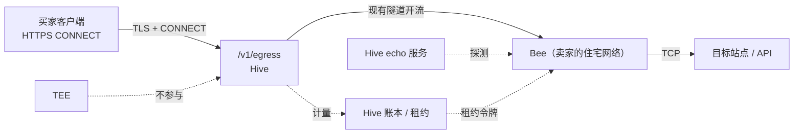

# TokenHive 住宅出口市场：设计方案（v2）

日期：2026-11-23
状态：中继模式已实现（Bee 卖家面 + Hive 租约与 CONNECT 数据面）；Hive 的账本 Wallet 适配器与半关闭帧仍待做，直连模式未实现
变更：按 2026-11-23 的审计意见重写。核心修正四处（佣金口径、时长计费与余额模型的冲突、包含额度的量级、TEE 探测的定位），新增三处上线阻断项（CONNECT 私网防护、逐租约签名令牌、与 token 供给的 IP 隔离），并给出传输层的选型论证（CONNECT / SOCKS5 / VLESS / XUDP / MASQUE）。原方案的差异见附录 A。

定位：本文描述一个只卖"住宅网络出口"的产品形态：买家带自己的凭据，TokenHive 提供一条从住宅 IP 出去的通道，并对这条通道收钱。与 [`remote-workspace-market.md`](remote-workspace-market.md) 是两条独立的产品线。

---

## 0. 结论摘要

1. **默认形态是 TCP CONNECT**，复用现有反向隧道的一条流承载一条 TCP 连接；买家的 TLS 端到端到目标，Hive 与 Bee 只见内层密文。
2. **TEE 不进入 egress**：不搬数据，也不做探测。出口证据由 Hive 自己的 echo 服务产生并由 Hive 签名，定性为"平台观测到的出口"，**不宣称 TEE 证明**。理由见 §6.3。
3. **时长费必须预付**。Hive 的余额模型不预留资金、允许扣成负数，后付的 `ip_hour` 收不到钱。v1 只卖预付租约块，未用部分按分钟退。
4. **按量费是主要收入**，包含额度按"每已开始小时 N MiB"计（原方案 1–5 GiB/小时是 720–3600 GiB/月，带宽成本高于 IP 租金本身，必然亏损）。
5. **质量不是档位而是连续分**，买家按 `min_score` 过滤，同分段内按价格排序。新卖家有置信区间与试用配额，避免"无数据→无单→无数据"的冷启动死锁。
6. 三件 P0 不做就不上线：**私网/端口/扫描防护**、**逐租约签名令牌**（Bee 验签，防止隧道被当成开放代理）、**与 token 供给的 IP 隔离**（否则爬虫流量会烧掉卖家的订阅账号）。
7. 不做的：UDP/QUIC（v1）、VLESS 本体、REALITY 类伪装、TEE 终结形态、共享 IP 的高保证档、"账号不被风控"的任何承诺。
8. **可选直连（§2.5）**：卖家有可映射端口时，买家直连卖家，Hive 只验证端点、签发租约；计费退化为"带宽·时间"预付，字节计量标注为卖家自报。默认关闭。

一句诚实的边界：**我们能证明"这条连接从那个 IP 出去"，不能证明"你所有的连接都从那个 IP 出去"。**

---

## 1. 卖什么、不卖什么

| 卖 | 不卖 |
|---|---|
| 一条从卖家住宅 IP 出去的 TCP 通道 | 厂商凭据、订阅额度、账号 |
| 出口的可观测属性：ASN 类别、地区、地址族、稳定性 | "账号不被风控"的承诺 |
| 通道的计量、租约与结算 | 买家流量内容的任何可见性 |
| 独占或共享的 IP 时段 | 机房 IP（明确拒收） |
| 平台签名的出口观测记录 | 第三方可验证的执行证明（见 §6） |

买家自带凭据，凭据不进平台、不进卖家机器。这一条只说明平台不承载内容；它**不**解除平台在"买家账号因该 IP 被风控"上的口碑责任（§9）。

---

## 2. 数据面形态与传输选型

### 2.1 形态 A：TCP CONNECT（默认，v1 唯一的形态）

买家向 Hive 的 `/v1/egress` 发 `CONNECT host:port`，Hive 在卖家的 Bee 隧道上开一条流，Bee 拨目标，双向复制字节。

- 买家侧协议：**HTTPS 代理语义**（TLS 到 Hive，再 CONNECT），同时接受 `Proxy-Authorization: Basic`，把 egress key 当作代理口令。这样 curl、浏览器、Python/Go SDK 都能直接用，不需要专用客户端。可选再暴露一个 SOCKS5（仅 CONNECT，无 BIND/UDP ASSOCIATE）。
- 复用现有 `tunnel`：13 字节头、最大帧 1 MiB、每流初始窗口 4 MiB、按流背压。一条流 = 一条 TCP 连接。**注意：现有 `KindClose` 是双向终止，没有半关闭**；CONNECT 客户端在发完请求后 `shutdown(SHUT_WR)` 是常见行为，因此需要给 tunnel 增加一个单向 FIN 帧（或给 `KindClose` 加 half 标志），否则买家半关闭会把响应一起掐断。这是 v1 必须做的协议扩展，不是"复用即可"。它还需要能力协商：旧版 Bee 会把未知帧当噪声忽略，半关闭会变成挂起，因此 residential 模式要求 Bee 在握手里声明支持 FIN，否则不派单。
- 语义要求：半关闭、空闲超时、每租约并发上限、字节与带宽硬上限、失败可区分（拨号失败 / 目标重置 / 卖家离线 / 策略拒绝）以便计费与退款。
- 外层代理细节：ALPN 锁 `http/1.1`；未带凭据时回 `407` + `Proxy-Authenticate: Basic`；`username = lease_id`、`password = egress key`，让一个买家可以同时持有多条租约而不混用出口。
- DNS 在 Bee 侧解析（这是"从那个地区出去"的一部分），因此目标域名会暴露给卖家的 ISP 解析器；需要 DoH 的买家可以在隧道内自己发 DoT/DoH（443 是允许的）。
- 加密事实：买家 ↔ Hive 是外层 TLS（Hive 终止）；买家 ↔ 目标是内层 TLS（端到端）。Hive 能看到内层 ClientHello 里的 SNI 与目标地址，看不到内容。**不要写"Hub 无法作恶"**，正确的说法是"Hub 无法读取内容，但能选择路由"。

### 2.2 UDP：v1 不做，理由写清楚

住宅代理的买家会需要 QUIC/HTTP3、DNS、VoIP。但：

- 在 TCP 复用上模拟 UDP（XUDP 的做法）会遇到 TCP 级队头阻塞。QUIC 的丢包恢复与拥塞控制建立在"底层不重传"的假设上；套在一条可靠字节流里，一次丢包会同时卡住所有流，并把重传放大成两层。**对 QUIC 来说，这种隧道的体验通常比直接回退到 TCP 更差。**
- 如果真要做 UDP，正确的位置是 Hive 与买家之间上 **MASQUE**（CONNECT-UDP，RFC 9298；CONNECT-IP，RFC 9484），跑在 HTTP/3 的 datagram 上，让丢包只在单条 QUIC 流内恢复。这是一个新的监听面 + QUIC 栈 + 连接迁移，属于独立的立项，不是 egress v1 的一部分。
- 立项条件：出现可量化的需求（例如 >5% 的买家调用因 QUIC 不可用而失败，或企业买家明确要求 DNS/游戏/VoIP），且愿意承担 QUIC 的运维成本。

### 2.3 从 VLESS / XUDP 借鉴什么，不借鉴什么

VLESS 是 Xray 的轻量无状态代理协议：1 字节版本 + 16 字节 UUID + 可选附加信息 + 指令（TCP/UDP/Mux）+ 端口 + 地址类型 + 地址，**自身不加密**，依赖外层 TLS/REALITY。XUDP 是 Mux 的扩展：在一条复用连接上给每个 UDP 包带上目标地址，从而在一个会话里实现 full-cone NAT。

| 借鉴 | 原因 |
|---|---|
| 紧凑流头（版本/指令/地址类型/地址/端口，几十字节） | 我们的流打开元数据已经是 JSON；可以换成定长二进制，省掉每次 CONNECT 的解析与字节 |
| 不在应用层重复加密，依赖外层 TLS | 与现有设计一致；我们已有端到端内层 TLS，再加一层只烧 CPU |
| 无状态鉴权、不依赖时钟 | 我们用"设备凭证 + 逐租约签名令牌"，比 UUID 白名单更适合计费与撤销 |
| 每包带目标地址的 UDP 思路 | 记入 §2.2 的 MASQUE 备选，不在 v1 实现 |

| 不借鉴 | 原因 |
|---|---|
| VLESS 本体 | 我们已有认证、多路复用、按流流控与背压；引入 VLESS 等于加第二套身份、第二套 mux、第二套错误模型，攻击面与运维都变大，而且买家必须装专用客户端 |
| REALITY / 流量伪装 | 我们是合法商业代理，不需要反审查伪装；这类能力一旦提供，会成为滥用基础设施，和 §9 的合规立场直接冲突 |
| XUDP | 见 §2.2：在 TCP 上模拟 UDP 会放大 HOL |
| XTLS Vision / splice | 它依赖在同机内识别内层 TLS 并做零拷贝转发；我们的 Hive 与 Bee 跨主机、且 Hive 不解内层 TLS，无法 splice |

**结论：协议层用标准 HTTP CONNECT（+ 可选 SOCKS5），把 VLESS/XUDP 的可取之处吸收进现有隧道，而不是把 VLESS 引进来。**

### 2.4 传输栈与容量预算（估算，需压测校准）

路径：`买家 --TLS--> Hive --WSS/隧道--> Bee --TCP--> 目标`，内层是买家的 TLS 密文。

- **Hive 的 CPU**：外层 TLS 两次对称运算（买家侧、Bee 侧）+ 一次转发拷贝 + WS 分帧。量级估算 300–600 Mbps/核，**规划单 relay 节点持续 ≤ 500 Mbps**，超出即分片。
- **成本**：Hive 出口带宽按 $0.05/GiB 计（§10 的单位经济以此为准）。
- **队头阻塞**：一条 WS 承载多流，TCP 丢包会阻塞同一隧道上的所有流。现有 4 MiB 每流窗口只能防单流饿死，防不了隧道级 HOL。缓解顺序：① 每 Bee 跑 1–4 条并行 WS，按流哈希分流（Phase 2，需把注册表从"一个 mux"改成"一组 mux"）；② 必要时把 Hive↔Bee 的载体换成 QUIC（Phase 3，改动大）。
- **延迟**：每个新 TCP 流多一次 Hive↔Bee 的建流往返（隧道内，不是公网 RTT）。探测按租约摊销（§6.2），**不要每连接探测**，否则短连接场景每个请求多一个公网 RTT。
- **与 token 供给隔离**：egress 用独立的流预算与 relay 池，不能吃满 TEE 中继的 1024 流上限或每 Bee 的 128 流上限；两类流量共享一条隧道时，带宽上限要分别计。

### 2.5 可选形态：买卖双方直连（Direct）

**定位**：Hive 只做撮合、端点验证与租约签发；数据面是买家直连卖家住宅 IP 的端口。它把 Hive 的带宽成本降到零、把路径缩到一跳，代价是**字节计量不可独立验证**，且卖家暴露面变大。默认关闭，卖家与买家都显式 opt-in。

**前提：卖家可被拨入。** 中继模式存在的理由就是家宽在 NAT 后；直连必须先解决"买家能连到卖家"：

| 路径 | 可行性 | 说明 |
|---|---|---|
| 公网 IPv4 + 端口映射 | 推荐 | 手工转发、UPnP、PCP、NAT-PMP 任一；CGNAT 无解 |
| 公网 IPv6 | 推荐（买家需 v6） | 无 NAT，防火墙放行即可；前缀随重拨变化，租约要短 |
| TCP 打洞 | 不做 | 成功率依赖 NAT 实现，排障成本高 |
| UDP 打洞 + QUIC | Phase 3 | 需要 QUIC 栈；与 §2.2 的 MASQUE 立项合并考虑 |

Bee 检测 NAT 类型与映射结果，上报 `endpoint`（公网 IP:port）；**Hive 通过这个 endpoint 发一条 CONNECT 到 echo 目标做探测**（不是只建 TCP），确认可达、且 **Bee 拨出去看到的出口 IP** 与租约声明一致，才标记 `direct_ready`。这个探测与 §6.2 的出口探测是同一件事，但走的是买家将来要走的那条路。

注意：**直连链路的地址族与出口地址族是两件事**。买家可以走 IPv6 连到卖家的 v6 endpoint，而 Bee 按租约用 IPv4 拨目标，目标看到的仍是卖家的 v4；反之亦然。租约里的 `family` 指出口族（§4.2），目录另列 `endpoint_family` 供买家判断自己能不能连。

**握手与传输**

- Bee 在公网端口跑一个最小 TLS 1.3 监听，自签证书；SPKI 指纹随租约下发，买家 pin，不依赖 CA。
- 协议不另造一套：就是标准的 HTTP/1.1 `CONNECT` + `Proxy-Authorization: Bearer <lease_token>`。Bee 用 §7.3 同一套 Hive 公钥验签令牌（令牌绑定 `transport=direct`），再按本地策略拨号。**不借 VLESS 的头部**：自有头部只会逼买家装专用客户端，标准 CONNECT 已经免费且兼容。
- 其后是双向字节，买家的内层 TLS 端到端到目标；Bee 只见密文。Bee 必须把业务 dial 绑定到与 `endpoint` 同一个出口接口——多宿主或开着 VPN 时，否则买家连的是 A 地址、目标看到的是 B 地址。
- 没有 Hive 在中间，所以没有 Hive 侧的流预算；凭据只有短 TTL 的租约令牌，绑定买家 key 指纹、`bps_cap`、`byte_cap`。

**计费：卖"带宽·时间"，不卖字节**

直连不经过 Hive，字节数只有双方自报。不要假装能计准，也不要搞"抽样回中继审计"——抽查不能结算，只会制造两套账。

- SKU 是 `direct_hour`，价格按卖家声明的 `bps_cap` 计价：`max(最低小时费, bps_cap_mbps × P_mbps_hour)`。
- 为什么不能按 IP·小时平摊：20 Mbps 跑满一小时约 9 GB；按中继的 $0.30/GiB 值 $2.70，而 $0.02/IP·h 的直连价会被瞬间套利。按带宽定价才对得上卖家真正让渡的资源（上行）。
- `byte_cap_total` 仍然存在，只作为硬停（Bee 本地执行），不参与计费。
- 退款按分钟；端点不可达、IP 漂移、卖家掉线都按分钟退。直连不做按量退款，因为没有可靠的在途证据。
- 平台佣金按 `direct_hour` 抽成；平台不承担带宽，单位经济反而更干净。
- 如果买家坚持按量：卖**预付字节包**（例如 10 GiB），Bee 本地扣减、用完即停；未用部分按 Bee 自报退，退款风险由定价覆盖。**不要做后付按量**——那等于把不可验证的数字当应收。
- 按量计费同时是滥用节流。直连去掉它之后，必须用更严的买家准入、目标基数限制与 `bps_cap` 补上，否则卖家 IP 的投诉率会上升。

**可审计性：降级，但要写在证据里**

- 租约开始时 Hive 拨 endpoint 探测：证明"这个 endpoint 从那个 IP 出去"，而买家接下来连的就是同一个 endpoint。
- 租约期间 Hive 可周期重拨复验（不在数据路径上，成本可忽略）。
- 字节数只有卖家（Bee 计数器）与买家自报；证据对象标注 `metering: "seller_reported"`，不提供按量结算。
- §6.2 L3 的缝隙不变：卖家仍可对业务流量做域名分流；直连只是让平台看得更少。

**安全与隐私**

- 卖家公网端口会成为扫描目标。Bee 只跑一个 TLS 监听、无 banner、握手前限速、令牌失败即断并计入封禁。
- 买家打卖家 LAN 的风险与中继模式相同，但少了 Hive 这层兜底：Bee 的私网/端口/字面量过滤必须默认开启，买家无法关闭。
- DDoS 成本从平台转移到卖家；这必须写进卖家协议。
- **买家 IP 会暴露给卖家**（中继模式下卖家只看到 Hive）。隐私敏感的买家应留在中继模式；这是必须披露的变化。
- 端点与令牌短 TTL、按租约轮换，降低被扫描利用的窗口。

**绕过平台（disintermediation）**

买家一旦知道 endpoint，双方可以私下换密钥、绕开 Hive。这是直连的固有风险，技术上无法消除。只能降低收益：租约短、端点与令牌轮换、把"介绍费"前置进时长价。平台的价值退化为"验证过的端点 + 争议处理 + 支付"，而不是数据面。

**适用与不适用**

- 适用：同区域、低延迟、大带宽；买家已完成 KYC 且有合同；卖家上行质量好、愿意承担暴露面。
- 不适用：合规敏感目标（平台看不到目标，无法留存）、CGNAT/移动卖家、隐私敏感买家、需要按量计费的买家。
- 目录单独标注 `transport=direct`，价格与中继分开；默认不展示，买家显式筛选。

**回退**：直连失败（端点不可达、TLS 失败、被限速）时，同一租约可回退到中继，并按中继的按量价补差；回退必须记录，不能静默切换出口（买家的目标侧白名单可能已经绑定 IP）。

---

## 3. 架构与职责



| 组件 | 职责 |
|---|---|
| **Hive** | 买家面 API（CONNECT、租约、续租、用量、证据查询）、出口策略（端口/类别/配额）、调度与定价、账本与佣金、探测调度、IP 历史与审计、风控 |
| **Bee** | 显式开启的 residential 模式、租约令牌验签、目标策略（私网/端口/卖家自设黑白名单）、并发与带宽上限、双向计数与上报、kill switch |
| **TEE** | 不参与 egress。继续只服务 token 业务（建连、凭证注入、回执） |

### 3.1 复用与改动清单（不要写"bee 几乎不用改"）

| 面 | 现状 | egress 需要的改动 |
|---|---|---|
| `tunnel` 分帧/流控 | 可复用 | **新增单向 FIN 帧**（半关闭）；可选 datagram 帧（v1 不做） |
| `/v1/agent` 注册、在线表 | 可复用 | 增加"可租"状态（探测通过、未暂停、未冲突）与心跳 |
| Bee 的 `targets` | 精确 `host:port`，最多 16 条 | **结构性不兼容**：新增 residential 配置段与逐流授权模型；不能用现有 targets 表达"买家任意目标" |
| Bee 的出口 | 只搬 AI 上游的密文 | 新增目标策略、私网过滤、租约验签、计数上报 |
| Hive relay | 源 IP 白名单只放行 TEE | 新增买家认证的 egress 端点、独立流预算、独立限速 |
| TEE | — | 零改动（这正是选形态 A 的主要收益） |

---

## 4. 租约：把"IP 时段"做成可计费、可撤销的对象

### 4.1 定义

```text
lease = { lease_id, seller_id, ip, family(v4|v6), mode(exclusive|shared),
          transport(relay|direct),
          starts_at, expires_at, price_snapshot, included_mib_per_hour,
          byte_cap, bps_cap, policy_hash, probe_evidence[], status }
```

价格在创建时锁定（与 token 业务"派发时锁价"一致），后续调价不影响在途租约。

### 4.2 状态机

```text
requested → probing → active → renewing → active
                    ↘ drifted（IP 变了）
                    ↘ suspended（卖家离线 / 平台故障 / 风控）
                    ↘ expired | released | revoked | terminated
```

- **先探测、再发租约**：买家看到的 `ip` 必须是 `probing` 阶段实测到的地址。
- **周期重探**（默认 5 分钟，A 级 1 分钟），不是每连接。
- **漂移处理**：租约创建时买家选 `on_drift = terminate | rebind`（独占静态默认 `terminate`，共享默认 `rebind`）。`rebind` 只允许同 ASN 同 /24 内变化，并 webhook 通知；跨前缀/跨 ASN 一律 `terminated` 并按分钟退款。自动改绑会改变买家已加白名单的 IP，必须是买家的选择。
- **租约期间同一 IP 不再租给第二个买家**（独占）；共享池是独立 SKU，明确披露同 IP 有其他租户，并按 per-IP 并发上限限制。
- **地址族固定**：租约记录 `family`（指出口族），探测与业务流都走该族。否则 Bee 可能从 AAAA 出去，而你探测的是 A 记录——"审计的 IP"就是假的。直连链路本身可以是另一族，二者不要混（§2.5）。

### 4.3 在线 ≠ 可租

必须同时满足：隧道有心跳（修参考实现里"半开连接仍算在线"的问题）、探测在有效期内、卖家未主动暂停、该 IP 未与 token 供给冲突（§7.6）。任一不满足即 `suspended`，不派新租约，已租的按 §5.6 处理。

### 4.4 选择规则：质量分下限 + 价格

买家请求可带 `country / region / asn_type / min_score / family / mode`。候选集内按 `price_per_hour` 升序，同价按 `score` 降序。**不做全局"最低价者胜"**，理由见 §8。

### 4.5 买家面 API（草案）

| 方法 | 路径 | 作用 |
|---|---|---|
| GET | `/v1/egress/offers?country=&asn_type=&min_score=&family=&transport=` | 可租 IP 目录（只显示 ASN/地区/分数/价格，不显示完整 IP） |
| POST | `/v1/egress/leases` | 创建租约（预付 N 小时，返回完整 IP + 证据） |
| POST | `/v1/egress/leases/{id}/renew` | 续租（余额不足即失败） |
| DELETE | `/v1/egress/leases/{id}` | 释放，按分钟退未用时长 |
| GET | `/v1/egress/leases/{id}/usage` | 字节、连接、失败、当前速率 |
| GET | `/v1/egress/usage` | 买家自己的购买量：累计字节、租约数、活跃租约 |
| GET | `/v1/egress/leases/{id}/evidence` | 签名证据（§6.4） |
| CONNECT | `/v1/egress` | 数据面；`Proxy-Authorization` 或租约 ID 绑定的 key |

---

## 5. 计费

### 5.1 计价单位

| 单元 | 计价对象 | 观测点 | v1 |
|---|---|---|---|
| `lease_minute` | 独占/共享占用的时间（**预付**） | Hive 租约状态机（唯一权威） | 有 |
| `direct_hour` | 直连租约的带宽·时间（预付，按 `bps_cap` 计价） | Hive 端点验证 + 租约状态机 | 有（仅直连） |
| `egress_gib_out` | 从卖家出口发往目标的字节 | Hive 转发计数；Bee 自报用于对账 | 有 |
| `egress_gib_in` | 从目标回到买家的字节 | 同上 | 有（单价更低） |
| `flow_count` | 新建连接数 | Hive | 无（长连接可规避，收益低、争议高） |

记账用 USD 定点小数（与 Hive 现有 `numeric(10,9)` 一致），不要沿用参考 hub 的整数微单位——那是仿真里的表示，生产账本是十进制。

计量时钟只用 Hive 的单调时钟。时长按秒累计、向上取整到分钟（避免"59 秒算 2 分钟"式的反向争议），租约结束时统一结算。

### 5.2 时长费：预付租约块

Hive 的规则是"请求开始前不预留、结算允许负余额、余额 > 0 即可发起新请求"。因此**后付的 `ip_hour` 一定收不到钱**：买家可以用极小余额租 24 小时然后离场。

v1 规则：

1. 只能购买 N 小时块（1 / 6 / 24），下单时一次性从**可提现余额**扣款（赠送额度不可用于 egress，见 §5.7）。
2. 按分钟计量，未用部分在 `release` / `expire` / `drifted` 时按分钟退回。
3. 余额不足以覆盖下一块时自动不续租，租约到期即断，不产生欠款。
4. 不提供"先用后付"的时长费；按量费可以后结（有 `byte_cap` 兜底）。

### 5.3 包含额度：重算并给出校验不等式

原方案"每 IP·小时含 1–5 GiB"等于每月 720–3600 GiB，按 $0.05/GiB 的 Hive 出口成本是 $36–180/月，而同类 IP 的月租金在十美元以内。**默认模式必然亏损。**

改为"每个已开始小时含 N MiB"，并强制校验：

```text
P_included_cost_per_day = N MiB/h × 24 × C_out_per_MiB
必须满足  P_included_cost_per_day ≤ 0.25 × seller_list_price_per_day
并且      P_overage_per_GiB ≥ 5 × C_out_per_GiB
```

示例取 N = 25 MiB/h（完全跑满约 600 MiB/日），已包含部分的成本约为售价的 6%。

### 5.4 价格与分成（示例，需市场校准）

| 项 | 示例值 | 说明 |
|---|---|---|
| `P_lease` | $0.02 / IP·小时 | ≈ $0.48/日，独占 |
| 包含额度 | 25 MiB / 已开始小时 | 超出按量 |
| `P_overage_out` | $0.30 / GiB | 是 Hive 出口成本的 6 倍 |
| `P_overage_in` | $0.08 / GiB | 下行便宜；仍高于 $0.05/GiB 的成本 |
| 卖家分成 | 报价的 80% | Hive 佣金 20%，**从报价中抽**（ADR 0037 的 take 口径） |
| 单租约硬上限 | `byte_cap_total`（默认 `bps_cap` × 时长） | 速率超限背压；字节超限终止租约并返回明确错误 |
| `P_mbps_hour` | $0.03 / Mbps·小时（示例） | 仅直连；按 `bps_cap` 计价，替代按量 |
| 直连最低小时费 | $0.05（示例） | `max(最低小时费, bps_cap_mbps × P_mbps_hour)` |
| 单买家并发 | 默认 16 流 / 租约 | 防单租约打满卖家上行 |

**注意佣金口径**：`买家应付 = 卖家报价`，`卖家实收 = 报价 × (1 − 佣金率)`。不要写成 `卖家价 × (1 + 佣金率)`——那是已被 ADR 0037 取代的 markup 口径。

### 5.5 双向计数取 min：给卖家一个对账依据

- 买家账单按 **Hive 的转发计数**（唯一能证明"买家确实收到了"的数），按方向分别计。
- 卖家结算按 `min(Hive, Bee)` 的同方向计数：Bee 报高了会被忽略，报低了只会少收，因此没有单边多收的空间。
- 但 `min` 不能防 Hive 少计。必须加一条：`|Hive − Bee| / max(Hive, 1) > 2%` 时告警，并把该租约标为 `reconciling`；卖家可在面板同时看到两个数并申诉，连续多个租约偏差的 relay 节点暂停接单。结算仍按 `min`，但偏差是运营事故，不是静默结果。
- 买家侧按 §6.4 的签名机制提供按租约的用量快照，让买家核对自己被扣的字节。
- 这是"回执保护卖家"精神在 egress 上的等价物，不需要 TEE。

### 5.6 失败、故障与 credit（保守规则）

| 情况 | 处理 |
|---|---|
| 卖家隧道掉线 / IP 漂移终止 | 按分钟退未用时长，并冲减该租约的 `pending` 收益；卖家记一次可用性事件；不承诺 SLA 赔偿 |
| 平台侧连续不可用 > 5 分钟 | 按分钟退未用时长并冲减 `pending` 收益；另按条款给不超过当日租金的服务 credit（不与退款重复，由平台承担，不扣卖家） |
| 单个目标不可达 / 目标主动重置 | 不退款（买家自选目标），不计卖家故障 |
| 被平台策略拒绝（端口/类别） | 不计费，不计卖家故障 |
| 买家自己断开 | 不退未用时长之外的部分；按量照计已转发字节 |
| 因滥用被平台切断 | 买家不回款；卖家按条款处理；保留证据 |

归因只能来自 Hive 的一手信号（流错误、租约心跳、卖家隧道注销）。**Bee 自报的错误不可作为退款依据**——它是卖家控制的。

### 5.7 反套现（这是时长计费最容易被利用的地方）

Hive 有"赠送额度"（不可提现、可消费）和"收益余额"（可提现）。如果 egress 允许用赠送额度购买自己的 IP 租约，就形成 **credits → 租约 → 卖家收益 → 提现** 的闭环，且 egress 没有上游成本，等于印钱。

必须做：

1. egress 只能用**可提现余额**支付；赠送额度不可用。
2. 买家与卖家不能是同一平台身份；同一实名/KYC、同一提现地址、同一设备指纹、同一 IP/前缀的买卖对一律拒绝。
3. 图分析：短时间内的环形资金流（A 买 B 的 IP，B 买 A 的）标记并冻结收益。
4. 收益 `holdback` 30 天（见 §5.9），争议期内可扣回。
5. 平台设 `P_lease` / `P_overage` 上限，防止用天价 IP 转移资金。

代价是持有大量 credits 的买家不能直接买 egress。若要支持，必须先有"credits 购买的租约不计入可提现收益"或等价的隔离账本，否则 §5.7 的闭环会重新打开。

### 5.8 计费示例

独占租约 6 小时，`P_lease = $0.02/h`，含 25 MiB/h：

```text
时长费        6 × 0.02                       = $0.120000
包含额度      150 MiB
实际出向      2.4 GiB = 2457.6 MiB
超出          2307.6 MiB = 2.253515625 GiB
按量费        2.253515625 × 0.30              = $0.676055（四舍五入到 6 位）
买家应付                                       = $0.796055
卖家实收      0.796055 × 0.80                 = $0.636844
Hive 佣金     0.796055 × 0.20                 = $0.159211
Hive 带宽成本  2.4 GiB × 0.05                 = $0.120000
Hive 毛利                                      ≈ $0.039211（含 CPU/探测/客服前）
```

（示例只计出向；入向按 §5.4 的低价另计。）

结论：**按量是利润来源，时长费只是占位与防囤积**。这也解释了为什么包含额度必须小：它直接吃掉毛利。

### 5.9 结算

沿用 Hive 的收益余额，不新造"周结"：

- 租约结束即产生 `pending` 收益，30 天后转 `available`（holdback，覆盖 ISP 投诉与滥用回溯窗口）。
- 提现走现有托管流程。
- 负余额只可能出现在按量费的尾部（`byte_cap` 已限制），由下一笔充值抵扣，不进入时长费。

---

## 6. 可审计性

### 6.1 信任模型：谁能证明什么

| 角色 | 能证明 | 不能证明 |
|---|---|---|
| TEE | 无（不参与 egress） | — |
| Hive | 某时刻从某 IP 出去了一条探测连接；某租约转发了多少字节 | 买家业务流量的真实路径（只能证明自己的路由决定） |
| Bee（卖家） | 自己的计数（用于对账） | 任何对买家有利的事实（它可篡改） |
| 买家 | 自己收到了字节、自己的 TLS 握手成功 | 出口 IP、Hub 是否改路由 |
| 目标站点 | 它看到了什么源 IP | 不对外提供 |

因此对买家的承诺只能是：**"Hive 在租约期间观测到该出口，并把这条观测签给你"**，不是"我们向你证明了你所有流量都走那里"。

直连模式（§2.5）更弱一档：Hive 能证明"这个 endpoint 在租约开始时从那个 IP 出去"，但租约内的字节与业务路径都看不到，证据里写 `metering: "seller_reported"`，不提供按量结算。

### 6.2 三层观测

**L1 控制面 IP（弱信号，低成本）**

Bee 拨入 Hive 时记录 TCP peer 地址，落 `first_seen / last_seen`。注意：`connect_proxy` 不作用于 Bee→Hive 的请求，但 `HTTPS_PROXY`、系统 VPN/TUN 会；所以控制面 IP **不等于**数据面出口。它的正确用途是**与探测 IP 比对**：不一致即降分或人工复核，而不是准入判据。

另外，家宽 IP 会被 ISP 重新分配给别的家庭。租约结束后该地址必须立即从可租集合移除，IP 历史保留 `released_at`，避免把新住户的地址继续算在旧卖家头上。

**L2 Hive echo 探测（主判据）**

Hive 在自己的隧道上向卖家开一条流，目标是 `n<nonce>.echo.<domain>`；echo 返回它看到的源 IP、ASN、地址族，Hive 把 nonce + 结果签名存证。这条 open 使用 §7.3 的 `kind=probe` 令牌，Bee 只接受 Hive 探测密钥签发、且只指向 echo 目标的探测流。

- 随机子域 + 每次探测新 nonce，防止卖家预置规则或回放。
- 2–3 个不同 ASN 的 echo 主机，避免单点被墙。
- **路径与业务流一致**：都走 Hive→Bee 的同一隧道与同一出口，这是它比"经 TEE 绕一圈探测"更贴近承诺的地方。
- **fail-closed 按租约**：探测不通过不发租约；已租的周期重探失败 → `suspended`。不要按连接探测（每个 CONNECT 多一个 RTT）。
- 探测目标不要用第三方公共 IP 站点：结果不一致、限流、ToS 风险。

**L3 业务路径（不可证，写进条款与 UI）**

卖家可以让探测走家宽、业务走别的出口。TLS 保护的是"字节没被改"，不是"从哪发出"。唯一看到业务源 IP 的是目标站点，它不告诉我们。

**产品硬约束**：任何文案不得越过"这条连接/hive 观测到的出口"。§9 的反方意见继续成立。

### 6.3 为什么把 TEE 移出 egress

原方案用 TEE 探测，收益被高估、成本被低估：

- **证明力错位**：TEE 签的是探测那条连接；业务流量不经过 TEE，恶意 Hive 仍可把业务流导去别处。也就是说，attestation 覆盖的恰好不是它想承诺的那条路径。
- **实现并不"零改动"**：`jobs/spec.go` 规定空 credential 的作业会被 TEE 拒绝；探测要么造伪 provider + 伪信封，要么改 JobSpec。前者污染凭证库，后者是协议变更。探测还会占用 ProviderSeq 与回执库，让卖家的 token 审计里混入不属于其订阅流量的条目。
- **发布成本**：白名单是被度量进 attestation 的。加一个 echo host = 改 policy hash = 一次发布，所有 pin 了旧 hash 的验证方都要同步。
- **性能**：TEE 是单点且有全局 1024 流上限，探测流量与 token 流量争抢同一中继。

**什么时候才值得把 TEE 放回来**：当"第三方可验证的出口证据"本身能卖出溢价（企业买家、需要向审计方交代），并且愿意为独立的 egress 证据服务付费时。即便如此，也只让 TEE **签探测**、不搬业务数据，并接受"它证明的仍只是探测路径"。

### 6.4 证据对象

```json
{
  "lease_id": "lse_...",
  "seller_id": "prv_...",
  "observed_ip": "203.0.113.7",
  "family": "v4",
  "asn": 64500,
  "asn_type": "residential",
  "country": "JP",
  "probe_target": "n9f3c1.echo.tokhive.example",
  "probe_at": "2026-11-23T10:00:00Z",
  "expires_at": "2026-11-23T10:05:00Z",
  "policy_hash": "sha256:...",
  "probe_kind": "lease_start",
  "hub_key_id": "egress-2026-11",
  "signature": "base64(ed25519(JCS(payload minus signature)))"
}
```

- 签名覆盖去掉 `signature` 后的 JCS 规范化 JSON；`policy_hash` 是端口/类别/私网规则版本的哈希，Hive 与 Bee 用同一份。
- 签名密钥公开（JWKS 风格），买家与卖家都能离线验证"这份观测确实是 Hive 签的、没被事后改"。
- 这只是**平台签名**，不是 TEE 证明；UI 与文档必须这么写。
- 证据按租约哈希可公开查询（不暴露买家身份），用于争议处理。

### 6.5 日志与隐私

- 记录：`租约 ID、目标 host:port、起止时间、双向字节、结果码`。不记录内容。
- 完整 host 保留 30 天（争议与滥用调查窗口），之后只留加盐哈希与按租约聚合的计数；`legal hold` 单独标记，不受自动删除影响。保留期按司法辖区可缩短，不默认延长。
- 完整 IP 只对**正在租用该 IP 的买家**可见；目录只显示国家/地区/ASN 类型/分数。
- 卖家 IP 属于个人数据：提供导出与删除流程，明确保留期，跨境传输按部署地区处理。

---

## 7. 安全

### 7.1 威胁模型

| 对手 | 目标 | 主要控制 |
|---|---|---|
| 恶意买家 | 打卖家内网、扫端口、发垃圾邮件、借卖家 IP 诈骗 | 私网过滤、端口白名单、扫描检测、实名、审计、封禁 |
| 恶意卖家 | 伪造住宅、探测作弊、超售、偷看明文 | ASN + 探测 + 画像、租约令牌、目标只放 443/80、明确披露 |
| 被窃 Bee 设备凭证 | 把 Bee 变成开放代理 | residential 模式默认关闭；逐租约签名令牌；Bee 端策略 |
| 恶意/被入侵的 Hive | 读内容、改路由、多计费 | 内层 TLS 端到端；Bee 验签租约；双向计数取 min；外部审计 |
| 第三方目标 | 把平台当攻击跳板 | 目标类别策略、速率限制、举报与下架 |
| 平台内部人 | 滥用日志、改账 | 最小权限、审计日志、双人复核 |
| 直连端点的扫描者 | 打满卖家上行、探测服务 | 单 TLS 监听、令牌鉴权、握手前限速、失败即封 |
| 直连下的买家/卖家 | 买家 IP 暴露给卖家；双方私下绕过平台 | 显式 opt-in 与披露；短租约与令牌轮换 |

### 7.2 买家侧：CONNECT 不是"转发任意字节"

必须先修好这些，再谈商业化：

1. **地址过滤（Bee 端，解析之后）**：拒绝 loopback、RFC1918、CGNAT(100.64/10)、链路本地(169.254/16)、组播、`0.0.0.0/8`、`192.0.0.0/24`、`198.18.0.0/15`、`240.0.0.0/4`；IPv6 的 `::1`、`fc00::/7`、`fe80::/10`、`2001:db8::/32`，**以及 IPv4-mapped IPv6**（`::ffff:192.168.1.1`，只按 v4 过滤会被绕过）。用 `netip` 判断，不要字符串前缀匹配。这是保护卖家 LAN 的最后一道，Hive 看不到解析结果。
2. **DNS 钉扎**：Bee 解析一次并把连接拨到已校验的 IP，避免 DNS rebinding 的 TOCTOU。买家内层 TLS 的 SNI 不受影响。
3. **端口策略**：默认只放 443；80 可选且提示"明文"；拒绝 22/23/25/445/465/587/3389/6379/11211 等。
4. **拒绝 IP 字面量目标**（Hive 侧），减少内网与扫描面。
5. **扫描与滥用检测**：每租约"不同目标数/分钟"上限、失败连接比例、短连接暴发；命中即限速并记入买家风险。
6. **硬上限**：每租约 `byte_cap`、每 IP `bps_cap`、每买家并发与新建速率。超过 `bps_cap` 用背压（不读买家 socket），不丢包计费；达到 `byte_cap` 必须**终止流并结束租约**（返回明确错误），只背压会让租约永远不结束。
7. **字面量与怪形式**：Hive 与 Bee 都拒绝 IP 字面量目标；Bee 也拒绝 `127.1`、`0x7f.1`、八进制等非常规数字形式。
8. **策略以 CONNECT host 为准**，SNI 只记录不拦截：CDN 场景下两者经常不同，按 SNI 拦截会误伤正常站点。

### 7.3 逐租约签名令牌（关键设计）

只靠隧道密钥授权"开任意流"会把 Bee 变成开放代理——`docs/tokhive-security-audit.md` 的 H2 已经指出，`/v1/relay` 开放时"任何能连到 Hub 的人都能把任意流桥进任一在线 agent 的隧道"。因此：

- 每个 egress 流打开时，Hive 附带一个**签名租约令牌**：`{jti, lease_id, seller_id, ip, family, transport, policy_hash, not_before, not_after, byte_cap_total, bps_cap, max_streams}`。
- Bee 用配对时下发的 Hive 公钥验签，检查 `jti` 未被重放、未过期、`policy_hash` 与本地一致，并在**租约级**维护累计字节与并发（不是每流一份 `remaining`，否则买家开 N 条流就能拿 N 份额度）。超过 `byte_cap_total` 即拒绝新流并关闭现有流。
- 令牌有效期取短（默认 5 分钟）并由 Hive 续签，使额度与撤销在 5 分钟内生效，无需给每条流单独签名。**令牌过期只拒绝新流，不切断在途流**；在途流只受租约级 `byte_cap_total` 与租约结束时间约束，否则一次大下载会被 5 分钟的令牌周期腰斩。
- 探测流用另一种令牌（`kind=probe`），只能由 Hive 的探测密钥签发、只能打开 echo 目标，且有独立速率上限；Bee 不接受没有令牌的 open。
- 令牌不绑定单个目标（那是开放代理），但绑定**策略哈希**与租约级上限，Bee 仍按本地策略逐流校验。
- 效果：即使 Hive 的 relay key 泄露、或买家拿到合法 API Key，也无法越过租约的上限、并发与策略；`residential` 模式默认关闭，卖家的旧配置不受影响。

### 7.4 买家认证

- 独立 scope 的 egress key（与 token 的买家 API Key 分开，可单独撤销）；`Proxy-Authorization` 的 `username` 是 `lease_id`，`password` 是 key。
- 必须 TLS 到 Hive；`Proxy-Authorization: Basic` 只是兼容形式，不允许明文 HTTP。
- 每 key 的并发、速率、日流量上限；异常即暂停并通知。
- 高风险画像（新注册、无充值历史、高风险地区）走正向 allowlist（前 7 天只允许 443 + 常见 API 域名）；正常买家默认放开 443 任意目标，但受目标基数与扫描检测约束。不要对所有新买家一刀切限制，否则会杀死采用率。
- **host 黑名单只是减速带，不是墙**：CONNECT 到任意 CDN/VPS 都能承载任意协议。

### 7.5 卖家保护与控制面

- `egress.json` 新增 `residential` 段，默认关闭；开启时明确列出：允许的端口、目标类别、带宽上限、可用时段、买家黑名单。
- 一键 kill switch（Bee 本地生效，不等 Hive）。
- 明确告知：80 端口是明文，买家与路径上的任何人都能看到；卖家可选择只卖 443。
- 卖家的上行被占满时，Bee 本地背压优先保证自己的正常上网（可配置保留带宽）。
- 域名规则（已实现）：`residential.rules` 按域名后缀匹配、最长后缀优先；`bps` 是该后缀的速率上限，`bps: 0` 直接拒绝该后缀及其子域，因此 `cn`、`ru` 这类国家后缀等价于按国家域名限速或封禁。规则只能收紧买家的速率，不能放宽。
- 买家匿名（已实现）：签给 Bee 的租约令牌不含买家 ID，Bee 只校验租约与卖家；卖家的出售量在 `/api/bee/egress/usage`（设备凭证鉴权）读取，买家用 `/v1/egress/usage` 只看自己的数据。

### 7.6 与 token 供给的隔离（硬规则）

同一个公网 IP 一边跑 OpenAI/Anthropic 订阅流量、一边被买家拿去爬站，目标站封 IP 会同时毁掉卖家的订阅账号和平台的 token 供给。

- token 供给优先：有活跃 token 会话的 IP 不出租；租约期间暂停该 IP 的**新** token 派单，允许已有会话完成；租约结束并冷却 10 分钟后恢复。
- 监控上游 403/429 与 egress 租约的时间关联，命中即下架该 IP 并复核。
- 两类流量的 relay 预算、限速、告警分开。

### 7.7 容量与 DoS

四级限额：全局 → 每 relay 节点 → 每卖家/IP → 每买家/租约。relay 按卖家分片，避免单节点打满；探测与数据面分开限流，防止探测把业务挤掉。

---

## 8. 质量分与市场

### 8.1 维度（全部由平台观测，不由卖家自报）

| 维度 | 数据来源 | 权重（初始） |
|---|---|---|
| 在线率（心跳） | Bee 隧道心跳 | 20% |
| 探测成功率与延迟 | Hive echo（多宿主） | 15% |
| 买家实测吞吐 p50 | Bee 侧交付速率（避免把买家自身慢链路算到卖家头上） | 25% |
| 流失败率（Hive 观测） | 隧道/拨号错误 | 20% |
| IP 漂移频率 | IP 历史 | 10% |
| 控制面/探测面 ASN 一致性 | L1 vs L2 | 5% |
| 黑名单命中（Spamhaus 等） | 离线查询 | 5% |

用**连续分 0–100**，UI 可映射成 A/B/C 展示，但决策用分数与置信下界。买家投诉**不进分数**（可被差评攻击），只作为运营与风控信号；确需计入时按买家信誉加权并单独展示。

### 8.2 冷启动

新卖家没有历史，硬阈值会把它永远锁在最低档（无单→无数据）。做法：

- 用"置信下界"排序（Wilson / Beta 后验的下界），新卖家从"未知但可试用"开始，而不是 0 分。
- 试用做成独立 SKU（"新卖家试用"：限 1 小时/次、每买家每日 2 次、限 443、限速），价格低于正式价，由买家自愿选择，平台不补贴；试用期观测进入正式评分。
- 坏历史按半衰期衰减（例如 14 天），允许修复，但不允许瞬时洗白。

### 8.3 反作弊

- **探测可被优先调度**：所以吞吐与失败率以买家实测为主，探测只占 15%。
- **买家恶意差评**：只统计 Hive 观测到的失败，不统计买家主观投诉的原始计数（去重、按买家信誉加权）。
- **卖家自买刷分**：§5.7 的自买检测同样适用于评分（自买产生的租约不计入质量分）。
- **代理农场**：精确 IP 唯一 + 每身份 IP 上限（例如 5 个）+ 前缀多样性披露 + 设备指纹/提现账户聚类。原方案的"同一 /24 一个 provider"对 CGNAT/移动会误杀，改为"同一精确 IP 一个卖家 + 每身份上限 + 农场检测"。

### 8.4 卖家可见与申诉

卖家面板展示每一项指标、当前分数、影响最大的扣分项与改进建议；提供申诉入口（人工复核，48 小时）。评分不可解释会直接变成客服成本。

### 8.5 IP 类型

`static_residential / mobile_cgnat / business`。目录支持按类型筛选；独占只对 `static_residential` 承诺"同一 IP 稳定"，`mobile_cgnat` 明确标注共享与漂移可能。IPv6 前缀常随 PPPoE 重拨或隐私地址轮换，**独占静态默认只承诺 IPv4**；v6 租约默认走共享档，并要求买家接受更快的漂移。

---

## 9. 滥用与合规

住宅出口是公认的滥用基础设施。这一节不是法律意见，是必须交给律师过一遍的清单。

| 风险 | 说明 |
|---|---|
| 卖家的一手责任 | 宽带被第三方用于发起请求，投诉先到 ISP 和卖家；多数家宽 AUP 禁止转售或长期对外提供服务 |
| 平台责任 | 明知是可滥用通道仍提供结算与撮合 |
| 目标类别 | 支付、政务、邮箱注册、社交登录、票务是高风险 |
| 身份与追溯 | 无实名无法配合调查，也无法自证尽责 |
| 地区差异 | 部分地区对"帮助信息网络犯罪活动"有明确条款 |

内建控制（不是可选项）：买卖双方实名（卖家与宽带账户一致）、连接元数据留存（host 30 天，之后聚合，见 §6.5）、目标类别策略（部署在 Hive，Bee 只做本地兜底）、举报入口与 24 小时响应、速率与并发上限、条款明确卖家第一责任与平台立即下架/扣留结算的权利、高风险买家的正向 allowlist 期、按地区下架。

两个必须写进条款的硬限制：

1. **目标站点无法联系平台**。它看到的只是卖家的住宅 IP；投诉会先到 ISP 和卖家，平台没有可被外部发现的滥用入口（家宽 IP 无法设置反向解析或 abuse 页面）。因此 24 小时响应只覆盖"平台已知"的举报，平台的滥用检测必须是主要手段。
2. **卖家把家宽转租给第三方可能违反其 ISP 的 AUP**，后果是卖家被断网；平台无法替卖家向 ISP 解释。签约时必须逐条告知。

另外，禁止将本服务用于违法内容、CSAM、攻击、欺诈与规避制裁。这是账户条款的一部分，技术控制不能替代它。

---

## 10. 经济学

三个必须正视的数字（假设 `C_out = $0.05/GiB`）：

1. **卖家的边际成本接近零**：家宽固定月费，多跑一个买家不增加成本。任何正价都会引来供给洪水，价格会压到"卖家风险溢价"而不是成本线。平台必须设底价，否则质量与合规成本无人承担。
2. **单 IP 的绝对收入很小**：$0.48/日 × 30 ≈ $14.4/月，卖家拿 80% ≈ $11.5。支撑它需要实名、风控、结算、客服、合规一整套固定成本，必须靠规模或企业客单价。
3. **Hive 在数据面上，带宽是变动成本**：每 GiB 收 $0.30、成本 $0.05，毛利 83%；但一旦包含额度过大或价格战打到 $0.06/GiB，就只剩几个点。**按量单价必须 ≥ 5× 出口成本，包含额度必须小。**

差异化只有两点：结算可核对（双向计数 + 托管提现），出口有平台观测与 IP 历史。这两点对企业买家有意义，对价格敏感的个人买家没有。

**推论：如果目标客户是"想省钱跑爬虫的个人"，这个产品没有生存空间；如果目标客户是"需要可审计出口的团队"，必须按企业标准做合规，早期利润会被合规成本吃掉。**

---

## 11. 反方意见（为什么可能不该做）

1. 买家真正想要的是"账号不被识别"，你卖的是 IP，交付的是 IP，差距由买家承担，但结果会归因到平台。
2. 核心承诺无法完全证明（§6.2 L3）。
3. 风险与收益不对称：每 GiB 毛利分角级，一次滥用事故的法务与公关成本高一个数量级。
4. 供给质量不可控：断电、换 IP、ISP 限速；体验方差远大于机房代理。
5. 它与 token 业务共享同一批卖家，却改变平台角色：从"撮合额度"变成"提供网络通道"，责任更重；而且会污染 token 业务的 IP 信誉（§7.6）。
6. 自买套现（§5.7）在纯时长计费下几乎是必然的攻击面，需要持续的图分析投入。

---

## 12. 最小验证路径

| 步骤 | 做什么 | 验证什么 | 成本 |
|---|---|---|---|
| 0 | **P0 安全底座**：私网/端口过滤、扫描限速、租约令牌、买家 scope、与 token 的 IP 隔离、tunnel 半关闭帧、Bee residential 模式 | 这套东西能不能安全地暴露在公网 | 3–4 周 |
| 1 | ControlIP + Hive echo 探测 + IP 历史 + ASN 分类（不含 TEE） | 供给里有多少是真住宅；控制面与出口是否一致 | 1 周 |
| 2 | 预付租约（先只卖 1 小时、独占、平台定价）+ 5 个买家手工结算 | 买家是否愿为"可验证出口"付溢价；卖家是否接受按租金 | 2 周 |
| 3 | 观测滥用率、投诉率、自买行为 | 这套供给能否长期承载 | 1 个月 |

总计约 8–10 周。若要在 4 周内出结论，砍掉质量分与共享池，只保留 P0 + 探测 + 预付租约。

Go/No-Go：第 2 步的复购率与溢价、第 3 步的投诉率（每千租约）与自买命中率。任一为负即停，不要用"再做六个月"去证明。

第 1 步是唯一"无论最终做不做都该做"的动作：它同时是 token 业务的供给质量门槛。

直连模式不进最小路径。只有当 ① 中继模式证明有真实需求，且 ② 至少 3 个卖家有可映射端口时，才按 §2.5 做 2 周试点；它的价值是"零带宽成本 + 低延迟"，不是"更高计费精度"。

---

## 13. 多维评估（v2 自评）

| 维度 | 结论 | 残余风险 | 下一步 |
|---|---|---|---|
| 性能 | 待验证（估算 300–600 Mbps/核） | 隧道级 HOL、Hive 单点带宽与 CPU、只支持 TCP、半关闭尚未实现 | 先压测再定容量；Phase 2 隧道分片；UDP 走 MASQUE |
| 可审计性 | 中 | 业务路径不可证；证据是平台签名，非第三方可验证 | 对外文案收紧；企业档再评估"TEE 只签探测" |
| 安全性 | 中上 | 买家滥用、被窃 Bee 凭证、卖家 LAN | P0 私网/端口/令牌/扫描检测；Bee 端策略与 Hive 策略双向兜底 |
| 收费公平性 | 中上 | Hive 少计无法被 min 发现、失败归因、自买套现 | min + 偏差告警/申诉 + 租约级退款 + 赠送额度禁用 + holdback |
| 供给质量 | 中 | 冷启动、CGNAT、探测作弊 | 连续分 + 置信下界 + 买家实测吞吐为主 |
| 合规 | 低（外部依赖） | 地区法律、ISP AUP、实名成本 | 律师评估；先做单地区、实名、留存与举报 |
| 直连（可选） | 未验证 | NAT 可达性、卖家暴露面/DDoS、绕过平台、字节不可计量 | 只对可映射端点的卖家开放；预付带宽·时间；显式 opt-in |

---

## 14 上线状态与兼容性（2026-11-23）

### 14.1 已实现

| 能力 | 位置 |
|---|---|
| CONNECT 代理、预付租约、逐租约 HMAC 令牌（令牌不含买家 ID） | Hive `internal/egress` |
| 目标策略（80/443、拒绝 IP 字面量与私网）、字节/速率上限、域名后缀规则（`bps: 0` 拒绝） | Bee `beewire` + `agent/egress_residential.go` |
| 买家扣款、卖家分成入账、释放时按未用分钟退款（卖家同比例回收） | Hive `service.EgressWallet` + `egress.Service` |
| 买家/卖家各自用量（字节、租约数、活跃租约） | `GET /v1/egress/usage`、`GET /api/bee/egress/usage` |
| Clash 订阅（每个活跃租约一个 `type: http` + TLS 代理） | `GET /v1/egress/subscription` |
| 计费防护：只用可提现余额支付、拒绝自买自卖、提前释放不退还已交付字节 | Hive `EgressWallet` + `egress.releaseRefund` |

默认价 $0.30/小时，含 1 GiB；平台佣金 30%。1 GiB 中继带宽约 $0.05，因此满用仍有正毛利；每个买家同时最多 4 个活跃租约。价格是默认值，卖家报价可覆盖。

计费口径（2026-11-23 补齐，对应 §5.7）：

- **只花可提现余额**（`withdrawable_balance`），赠送/管理员加款不可购买 egress，否则「赠送额度 → 自家出口 → 卖家收益 → 提现」闭环成立。退款原路退回可提现部分。
- **拒绝自买**：卖家的账户不能租自己的出口（`self_dealing`）。
- **提前释放只退时间，不退字节**：退款上限为 `price − price × 已用字节 / 包含额度`，包含额度跑满即 0 退款。否则买家可以几分钟跑满 1 GiB 再释放，只为分钟付费，平台替它付带宽。
- 卖家分成跟实际退款同比例回收，平台不吞差额。

### 14.2 兼容与灰度

- 租约令牌带 `v`（当前 1）；Hive 与 Bee 都只接受已知版本，未知版本被拒绝而不是误解。
- Bee 在连接头 `X-Bee-Controls` 中声明 `egress`；Hive 只把声明了的设备列为卖家。旧 Bee 不声明→不被派单，但仍正常提供 token 供给；旧 Hive 看到未知声明会忽略。
- 因此升级顺序不受限：先升 Hive（egress 暂时没有卖家）或先升 Bee（暂不被列入卖家）都不会产生错误派单，也不会影响既有的 token 业务。

### 14.3 未实现（不阻塞现有 token 业务）

- 卖家收益 30 天 holdback（§5.9）：卖家在租约创建时就入账，收益可立即提现。合谋的两个账号可以「买家付款 → 卖家提现 → 买家释放」套走卖家分成，回收只能把卖家余额扣成负数。自买自卖已被拒绝，但跨账号合谋要等 holdback 才能关闭。

- 隧道半关闭（单向 FIN）：买家 `shutdown(SHUT_WR)` 会连带关闭响应。
- VLESS / XUDP：不做；客户端用标准 HTTP CONNECT 或 Clash 订阅接入。
- 订阅按国家/中国组分组：需要卖家的国家元数据，目前 `Seller` 无国家字段，订阅只输出“全部”。
- 质量分、探测、IP 漂移处理、用量持久化（当前用量在进程内存，重启归零；账单以钱包流水为准）。

## 附录 A：与原方案（v1）的差异

| v1 | v2 | 原因 |
|---|---|---|
| 形态 A + 形态 B（TEE 终结） | 只保留形态 A | B 需要 TEE 放开任意目标，等于拆掉被度量的白名单；若只允许固定 AI 端点，B 就是现有 token 产品 |
| TEE 经 relay 探测出口 | Hive echo 探测 | TEE 证明的是探测路径，不是业务路径；且 JobSpec 拒绝空 credential、白名单变更=发布、污染 ProviderSeq |
| `买家应付 = 卖家价 × (1 + 佣金率)` | `买家应付 = 报价`，`实收 = 报价 × (1 − 佣金率)` | 与生产 Hive 的 ADR 0037 一致 |
| `ip_hour` 后付 + 按未用时长退款 | 预付租约块，按分钟退 | Hive 余额可为负、无预留，后付收不到钱 |
| 每 IP·小时含 1–5 GiB | 每已开始小时 25 MiB，并给校验不等式 | 原值等于每月 720–3600 GiB，带宽成本高于 IP 租金 |
| 整数微单位 | USD 定点小数 | 与 Hive `numeric(10,9)` 一致；微单位是参考 hub 的仿真表示 |
| "复用 `/v1/agent` 原样"/"bee 几乎不用改" | 明确列出 Bee 的结构性改动 | Bee 的 `targets` 是精确 host:port、最多 16 条，无法表达任意目标 |
| 档位 A/B/C（硬阈值） | 连续分 + 置信下界 + 试用配额 | 新卖家冷启动死锁；探测延迟可被优先调度刷分 |
| 同一 /24 只允许一个 provider | 同一精确 IP 一个卖家 + 每身份上限 + 农场检测 | CGNAT/移动共享 /24，硬规则会误杀供给 |
| 缺 CONNECT 私网防护 | P0：Bee 解析后过滤私网 + Hive 端口/字面量策略 + 扫描检测 | 买家可打卖家 LAN 与云元数据 |
| 缺与 token 的 IP 隔离 | P0 硬规则 | 爬虫流量会烧掉卖家订阅账号与平台供给 |
| 无租约令牌 | 逐租约签名令牌，Bee 验签，租约级额度 | 防止隧道被当成开放代理（安全审计 H2），并防止按流复制额度 |
| 未提半关闭 | tunnel 新增单向 FIN 帧 | 现有 `KindClose` 双向终止，CONNECT 客户端 half-close 会掐断响应 |
| 无探测鉴权 | `kind=probe` 专用令牌 | 防止任意人让 Bee 去连 echo 目标 |
| 周结 | 收益余额 + 30 天 holdback | 不新造周期；复用托管与提现 |
| "Hub 无法作恶" | "Hub 无法读内容，但能选路由" | 精确表述 |
| 未提 UDP / VLESS / XUDP | §2.2 / §2.3 给出选型与拒绝理由 | 避免"用 XUDP 解决 UDP"这种在 TCP 上放大 HOL 的方案 |
| 只允许中继 | 可选直连（§2.5） | 平台带宽成本归零、延迟更低；代价是计量与合规降级、卖家暴露面变大 |

## 附录 B：证据与计量的边界

- 证据只能覆盖 `probing` 与周期重探时刻；两次探测之间卖家改路由不可见。
- `min(Hive, Bee)` 只能防单边虚报，不能防双方合谋（卖家与买家同一人，见 §5.7）。
- 双向计数在 TLS 记录边界上可能差几个字节（关闭时的半包），默认 `|Δ| ≤ 4 KiB/租约` 视为噪声；阈值可配，超过即进 `reconciling`（§5.5）。
- Hive 少计无法被 `min` 发现，只能靠偏差告警与申诉；这是平台签名证据的固有上限。
- 直连模式的字节只有双方自报（`metering: seller_reported`），不参与结算；任何"按量"承诺在直连下都不成立。
- 任何"可验证"的宣传都必须同时给出这些限制，否则就是把 §6.2 L3 的缝隙藏起来。
